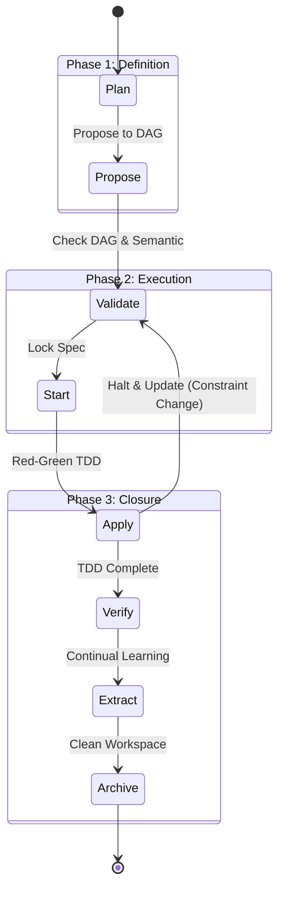

# Contributing to NicheAI

Welcome! This document outlines our standard development, testing, and release workflows. By following these guidelines, you help us keep the codebase healthy, history clean, and releases predictable.

## 1. Feature Planning (The OpenSpec Workflow)

Before writing _any_ code for new features, we use a structured documentation process called **OpenSpec**, acting as a State Machine designed for Human and AI collaboration.

### The 8-Step Lifecycle

### Phase 1: Definition

- **1. Plan:** Ideation and collision detection.
  - _Actor:_ Human & AI (`/create-openspec` or manual markdown in `openspec/plans/`).
  - _Pre-condition:_ Run `npm run openspec detect-collisions`.
- **2. Propose:** Introduce the plan to the DAG.
  - _Command:_ `npm run openspec propose openspec/plans/<plan>.md`
  - _Output:_ Scaffolds `proposal.md`, `design.md`, `spec.md`, and `tasks.md`.
- **3. Validate:** Automated DAG verification and semantic checks.
  - _Command:_ `npm run openspec validate` and `npm run openspec ai-eval`
  - _Output:_ Semantic pass records.

### Phase 2: Execution

- **4. Start:** Lock spec & generate GraphRAG context.
  - _Command:_ `npm run openspec start <feature-name>`
- **5. Apply:** Red-Green TDD implementation.
  - _Actor:_ AI Agent (using `@apply-openspec` skill) or Human.
  - _Escape Hatch (Halt & Update):_ If constraints change mid-flight, update `design.md` and re-run `start --auto-fix` (which loops back to Validation).

### Phase 3: Closure

- **6. Verify:** Check coverage and intent-based tests.
  - _Actor:_ AI Agent (`@verify-openspec`).
  - _Command:_ `npm run openspec check-coverage <feature-name> --threshold=90`.
- **7. Extract:** Continual learning.
  - _Actor:_ AI Agent (`@extract-lessons`).
  - _Output:_ Sets `learnings_extracted: true` in `.openspec.yaml` and updates `AGENTS.md`.
- **8. Archive / Supersede:** Cleanup and state resolution.
  - _Actor:_ AI Agent (`@archive-openspec`).
  - _Output:_ Spec moved to `openspec/archive/changes/`.

> **For AI Agents:** Always use the `--non-interactive`, `--json`, `--force`, and `--dry-run` flags when interacting with the CLI to prevent hangs and enable structured parsing.

## 2. Testing Standards (The Testing Trophy)

We follow the [Testing Trophy](https://kentcdodds.com/blog/the-testing-trophy-and-testing-classifications) methodology, prioritizing Integration tests over highly mocked Unit tests.

1. **Unit/Integration Tests (Vitest):** Use React Testing Library to render components. **Do not use `vi.mock` for internal hooks or network requests.** Instead, use Mock Service Worker (MSW) to intercept and mock network boundaries (APIs, Firebase, Gemini).
   - MSW handlers are located in `src/test-utils/handlers.ts`.
   - Global MSW setup is in `src/setupTests.ts`.
2. **E2E Tests (Playwright):** For end-to-end testing, we use API Seeding to provision the required state before the test executes, bypassing slow UI setup steps.
   - Reusable network/API seeding functions are located in `e2e/utils/db-seed.ts`. Use these inside `test.beforeEach` to prepare your test environment.
3. **Flaky Test Quarantine Policy:** If a Playwright test becomes flaky (fails intermittently in CI), it must be immediately moved to a `e2e/quarantine/` directory or skipped with `test.skip()`. Flaky tests erode trust in the CI suite and are not permitted in the active run. They must be fixed or rewritten before being reintroduced.

## 3. Commit Standards (Conventional Commits & Atomic Commits)

We strictly adhere to [Conventional Commits](https://www.conventionalcommits.org/en/v1.0.0/). This ensures our automated versioning tools (`semantic-release`) can parse commit history to bump versions and generate changelogs accurately.

Additionally, we practice **Atomic Commits**: Each commit should represent one logical, self-contained change. Do not mix unrelated refactors with new features in the same commit.

Our local Git hooks (managed by `lefthook`) run `commitlint` on the `commit-msg` hook to prevent invalid messages from being pushed.

**Valid Formats:**

- `feat: add new reporting dashboard` (New feature, triggers Minor bump)
- `fix: resolve crash on login` (Bug fix, triggers Patch bump)
- `chore(deps): update apollo-client` (Tooling/Maintenance, no release)
- `docs: update setup guide` (Documentation only, no release)

_(Note: Adding `!` after the type, e.g., `feat!: change API response format`, denotes a Breaking Change)._

## 4. Pull Requests & Merging

When you're ready to merge your code into `main`:

1. **Pass CI:** All PRs must pass the GitHub Actions CI pipeline, which runs Unit tests and Playwright E2E matrix shards.
2. **Squash and Merge:** We use the **Squash and Merge** strategy to merge into `main`.
3. **Final Commit Message:** You _must_ ensure that the final squashed commit message adheres to the Conventional Commits format, as this is the message that will trigger the automated release.

## 5. Versioning & Releases

We use automated CI/CD pipelines to manage versions, but you can read all about our process in our dedicated guide:

👉 **[How to Manage Releases & Versioning](docs/onboarding/how-to/manage-releases.md)**

---

### Need Help?

If you're ever stuck on setup, refer back to the [README Quick Start](README.md), or ask the AI agent to explain the repository structure.
