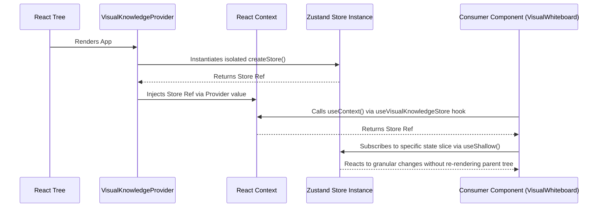

# ADR 001: Context-Bound Vanilla Zustand Stores

## Status

Accepted

## Context

As the application grew (specifically the Visual Whiteboard module), we encountered two significant issues with the standard Zustand singleton approach:

1. **Test Bleeding**: Because Zustand's `create` method instantiates a global singleton module, state leaked between Vitest test files. This forced us to use `isolate: true` (which dramatically slows down test execution and complicates MSW/JSDOM setups) or manually reset the store in `afterEach` blocks.
2. **Re-render Cascades**: In complex ReactFlow components, broad subscriptions to a global store triggered massive React re-renders, causing noticeable UI jank.

## Decision

We decided to adopt the **Context-Bound Vanilla Zustand Store** pattern, combined with `useShallow`.

- We create a pure vanilla store instance (`createStore`) dynamically rather than statically.
- We wrap this store instance in a React Context Provider (`<VisualKnowledgeProvider>`).
- We export an overloaded, strongly-typed custom hook (`useVisualKnowledgeStore`) that consumers use, forcing them to select via `useShallow` from the context.

## State Injection Flowchart

## Consequences

### Positive

- **Test Isolation**: Tests can easily mount `<VisualKnowledgeProvider>` around a component. Because a fresh store instance is created per Provider mount, state leakage is eliminated.
- **Granular Rendering**: `useShallow` ensures that only the deeply-nested components that actually use modified state re-render (e.g., adding an edge doesn't re-render the entire whiteboard).

### Negative

- **Setup Complexity**: More boilerplate than a simple `import { create } from "zustand"`.
- **Outside Component Access**: Accessing state outside of React components (like inside an API fetcher) requires a monkey-patched `getState()` method because the context is inaccessible there.
