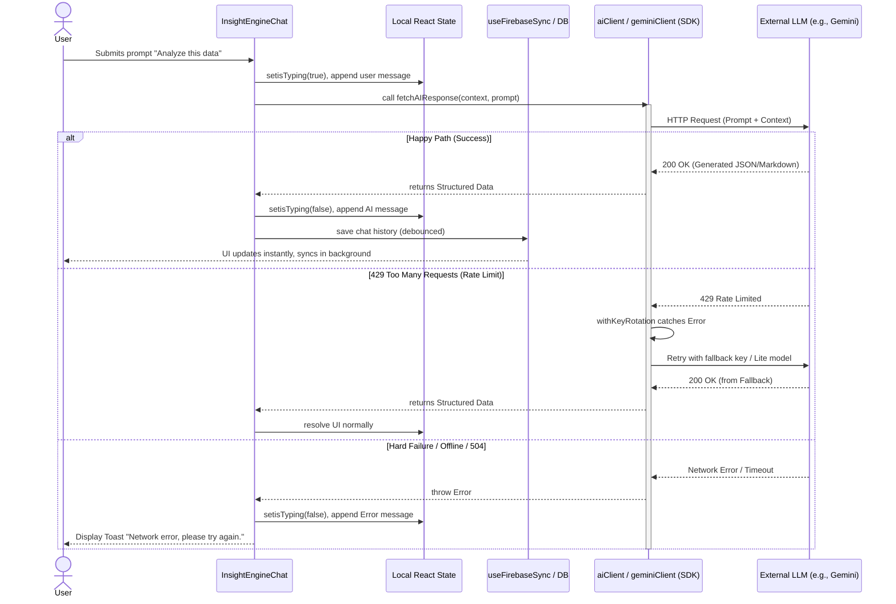

# AI Client Sequence Flow

The application integrates with several LLM providers (Gemini, Claude, OpenAI) to process market data and generate insights. Because these calls are asynchronous, expensive, and subject to rate-limiting, we employ an orchestration layer that handles retries, state fallback, and UI resolution.

