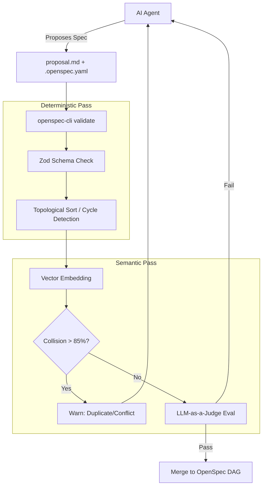

# OpenSpec DAG Engine & Deterministic Validator

## Overview

Transform the OpenSpec system into a rigorous, machine-learning-optimized Directed Acyclic Graph (DAG) for AI agents. This aligns with top-tier (Google, OpenAI, DeepMind) engineering practices for Spec-Driven Development (SDD). We will introduce a deterministic Node.js CLI validator to enforce DAG integrity, semantic collision detection to prevent feature bloat, and a GraphRAG approach to context optimization.

## Problem Statement / Motivation

Currently, OpenSpec relies entirely on LLM prompt instructions (`.cursor/rules`). While powerful, LLMs are prone to hallucination, which can lead to circular dependencies, invalid state transitions, and context window collapse as the DAG grows. To scale this system to handle dozens of AI-generated features, we need deterministic guardrails, CI/CD evals, and structured context management.

## Proposed Solution

Build the **OpenSpec DAG Engine**, a hybrid architecture combining a strict deterministic CLI orchestrator with advanced ML heuristics.

1. **Deterministic CLI Validator (`openspec-cli`)**: A Node.js tool that parses `.openspec.yaml` files, validates the schema (using Zod), and ensures the graph is acyclic (no circular dependencies).
2. **Semantic Collision Detection**: Implement vector embeddings to detect duplicate or conflicting specs before they are created.
3. **GraphRAG Context Optimization**: Generate hierarchical community summaries of the DAG so AI agents can traverse large dependency trees without exceeding context windows.
4. **CI/CD Hybrid Evals**: Integrate a pre-commit hook that runs the deterministic pass (schema/cycles) followed by an "LLM-as-a-Judge" semantic pass.

## Technical Approach

### Architecture

### Implementation Phases

#### Phase 1: Deterministic State Management (The CLI)

- Create a Node.js CLI tool (`openspec-cli`) inside the repository.
- Define strict Zod schemas for `.openspec.yaml` (enforcing statuses like `draft`, `in_progress`, `completed`, `superseded`, `blocked`).
- Implement a topological sort algorithm (using Depth-First Search) to detect cycles in `depends_on` and `blocks` arrays.
- Add a pre-commit hook (e.g., Lefthook) to run `openspec validate`.

#### Phase 2: Semantic Collision & Embeddings

- Integrate a lightweight vector embedding script (e.g., using `transformers.js` or OpenAI embeddings).
- When a new `proposal.md` is drafted, embed it and calculate cosine similarity against existing specs.
- If similarity crosses a threshold, the CLI warns the agent of a potential collision and suggests using `superseded_by`.

#### Phase 3: GraphRAG & Context Optimization

- Implement a command `openspec context <feature-name>` that outputs a strictly bounded context string for the AI.
- The context will include the target spec, direct dependencies (full text), and higher-level abstracted summaries of the rest of the DAG to prevent "lost in the middle" context collapse.

#### Phase 4: Evals & Integrity (CI/CD)

- Build an "LLM-as-a-Judge" eval script that runs after the deterministic pass.
- Evaluates specs on isolated dimensions: Implementation Ambiguity, Architecture Constraints, Backward Compatibility.

## Acceptance Criteria

- [ ] `openspec-cli validate` successfully catches circular dependencies (e.g., A depends on B, B depends on A).
- [ ] Zod schema rigidly enforces valid `.openspec.yaml` configurations.
- [ ] Semantic collision detection flags specs with high similarity.
- [ ] `openspec-cli context` generates an optimized markdown prompt for the AI agent without exceeding context limits.
- [ ] The OpenSpec CLI is integrated into the pre-commit hook.

## References & Research

- Top-tier SDD patterns (Constrained decoding, Pydantic/Zod validation, Topological State Machines).
- GraphRAG methodologies (Hierarchical Community Detection, Leiden algorithm).
- Hybrid Validation Pipelines (Deterministic Pass + Semantic Pass).
