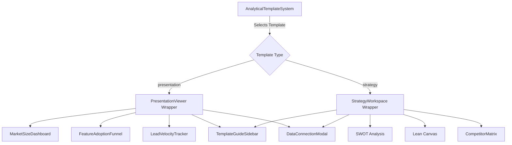

# Analytical Template Library Redesign

## Overview

Redesign the existing template feature to create a robust, cutting-edge analytical template library for Product, GTM, and Competitor research. The update will align with the Brutalist "Command Center" design identity, make templates intuitive with dynamic dummy-to-live data integration, and add contextual guides/documentation to teach users how to leverage them.

## Problem Statement

The current template system is rigid (hardcoded views in `PresentationViewer`), lacks deep documentation, and does not provide an intuitive path from previewing a template with dummy data to connecting live data for actionable insights. We need a flexible architecture that "doubles down" on product, competitor, and market research by offering specialized templates that instantly convey value.

## Proposed Solution

1. **Dynamic Template Routing:** Refactor `AnalyticalTemplateSystem`, `PresentationViewer`, and `StrategyWorkspace` to act as dynamic layout wrappers for modular template components.
2. **New Critical Templates:** Introduce 3 essential new templates:

- **Product:** Feature Adoption & Drop-off Funnel
- **GTM:** Lead-to-Close Pipeline Velocity
- **Competitor:** Competitor Feature & Pricing Matrix

3. **Frictionless Data Onboarding UX:** Introduce interactive previews with rich dummy data and a seamless mapping modal to connect real data sources.
4. **Contextual Guides Drawer:** Implement a slide-out sidebar containing a 5-part guide for each template (Why, Prerequisites, Setup & Mapping, How to Read, Next Actions).

## Technical Approach

### Architecture

### Implementation Phases

#### Phase 1: Dynamic Routing & UI Foundation

- Refactor `src/components/templates/PresentationViewer.tsx` to dynamically load dashboard sub-components based on `templateId` instead of hardcoding the "Market Size" layout.
- Create a `TemplateGuideSidebar.tsx` component that slides out from the right, rendering markdown-based guides for the active template.
- Implement the `DataConnectionModal.tsx` for visual field mapping and API authentication.

#### Phase 2: Core Templates & Dummy Data Engines

- **Feature Adoption Funnel (Product):** Implement a funnel visualization using Recharts. Include a dummy data generator that simulates user drop-offs across onboarding stages.
- **Lead-to-Close Velocity (GTM):** Create a time-series area chart tracking cohort conversion times, utilizing the existing LTTB downsampling utility for performance.
- **Competitor Matrix (Competitor):** Build a hybrid data grid allowing users to sync automated data (e.g., G2 reviews) alongside manual cell edits (e.g., feature checkboxes).

#### Phase 3: Documentation & Guides

- Write a structured 5-part guide for each template:
  1. **The Why**: What business question this answers.
  2. **Prerequisites**: Required data sources.
  3. **Setup**: Visual field mapping instructions.
  4. **How to Read**: Signal interpretation.
  5. **Next Best Actions**: In-app execution links.
- Embed guides directly into the `TemplateGuideSidebar` using MDX or a custom markdown renderer that supports Brutalist styling.

## References

- Existing UI: `src/components/AnalyticalTemplateSystem.tsx`
- Existing Dashboard Logic: `src/components/templates/PresentationViewer.tsx`
