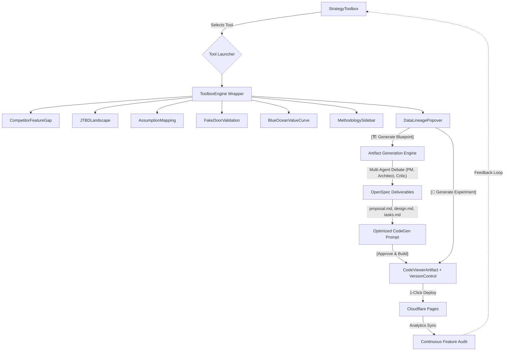

# Strategy Toolbox

## User Value Proposition

**De-risk your product before writing a single line of code.**

Founders and Product Managers waste months and thousands of dollars building features nobody wants. Traditional market research is slow, manual, and disconnected from the actual product development cycle. The Strategy Toolbox acts as an AI-powered Chief Product Officer—it automatically gathers market intelligence, applies battle-tested frameworks (JTBD, Blue Ocean, Assumption Mapping), and tells you exactly where the market gaps are.

**Why use this tool?**
To stop guessing what users want. This tool transforms vague ideas into empirically backed product strategies.

**What is the expectation of the result?**

- **Instant Clarity:** No manual data entry. The system ingests competitor reviews and sentiment automatically.
- **Actionable Visuals:** Clear, data-backed visualizations (e.g., a quadrant showing high-importance, low-satisfaction features).
- **Strategic Direction:** Definitive recommendations (e.g., "Build feature X because Competitor Y's users hate their implementation of it").
- **Immediate Next Steps:** Seamlessly turn insights into experiments (Fake Door test) or generate a PRD and MVP code.

**The Best Case Scenario (The "Magic" Moment):**
A founder enters their competitors, opens the **JTBD Opportunity Landscape**, and the AI highlights a specific "Job" that is highly important but terribly served by incumbents. They use **Assumption Mapping** to identify the riskiest assumption, launch a **Pretotyping (Fake Door) Validation** campaign directly from the platform, and within 24 hours have empirical data proving demand. They then click "Generate MVP" and the system outputs the exact code and specs needed. **Result: They found product-market fit before spending a dime on engineering.**

## Overview

Replace the static "Analytical Template Library" with a dynamic, data-driven **Strategy Toolbox**. Instead of users filling out generic templates, they will run specific methodological tools (e.g., Competitor Feature Gap, Assumption Mapping) that automatically pull required data, analyze it, and present tailored, interactive visualizations. This shift transforms the system from a passive display into an active product strategy engine.

## Problem Statement

The current template system is rigid, lacks deep documentation, and feels like a passive form-filling exercise rather than a powerful analytical tool. Users need an intuitive path from market discovery to feature delivery. We need a flexible architecture that organizes these tools logically and presents them with a cohesive, modern UI that explains _why_ the tool is being used and _what_ data is driving it.

## Proposed Solution

1. **The Strategy Toolbox Architecture:** Replace `AnalyticalTemplateSystem` with a `StrategyToolbox` component. Tools are selected from a central hub and launch into dedicated analytical views (`ToolboxEngine`).
2. **5 High-Value Early-Stage Tools:**
   - **Competitor Feature Gap & Sentiment Matrix:** 4-Quadrant Bubble Chart correlating competitor features against market dissatisfaction, identifying vulnerable gaps ripe for disruption.
   - **JTBD Opportunity Landscape:** Scatter plot ranking customer "Jobs" by Importance vs. Current Satisfaction to find highly underserved needs.
   - **Assumption Mapping (Riskiest Assumption Test):** Interactive 2x2 Matrix plotting hypotheses by Importance vs. External Evidence, highlighting assumptions that could kill the business.
   - **Pretotyping (Fake Door) Validation Dashboard:** Layered funnel and validation thermometer tracking real purchase intent (e.g., ad clicks, email captures) before writing code.
   - **Algorithmic Blue Ocean Value Curve:** Multi-line area chart normalizing diverse data points (price, usability) to map your proposed value against competitors and find uncontested space.
3. **Clean & Modern UI/UX:** Align the Toolbox with the "Clean & Modern" aesthetic of `MyProduct.tsx` and `MarketDataGrid.tsx` (card-based, serif headers, subtle backgrounds) rather than the harsh Brutalist style.
4. **Contextual Methodology & Data Lineage:** Every tool will feature a prominent "How to Read This Tool" section and use interactive hover-states (popovers/tooltips) to explicitly show the lineage of the data driving the visualization.
5. **Seamless Rapid PDLC Integration (Idea to Experiment):** The Toolbox is not a dead-end dashboard. Every actionable insight (e.g., an underserved JTBD, a high-risk assumption) features a "Generate Experiment" action that immediately bridges into the Copilot Canvas. From there, users can iteratively generate code, version it (pin/name specific builds), deploy instantly to Cloudflare Pages, and track live adoption analytics to close the feedback loop.
6. **Continuous PDLC Integration (Insight -> Code -> Deploy -> Audit):** Ensure the Toolbox isn't a dead-end. Insights generated by the tools seamlessly feed into the `RapidPdlcWorkflow` where users can iteratively generate code, version it (pin, name, deploy), push instantly to Cloudflare Pages, and loop real-world analytics back into the Toolbox via a Continuous Feature Audit dashboard.

### Research Insights

**Best Practices (Early-Stage Strategy & Modern UI):**

- **Optical Honesty & Data Lineage:** Tools shouldn't just present data; they must prove it. Hover states (`Tooltip`) should be heavily utilized on data points to show exact lineage (e.g., "Dissatisfaction Score: 85% (Aggregated from 412 1-star G2 reviews mentioning 'reporting')").
- **Methodology Explanations:** Every tool must have an integrated, highly visible explanation panel detailing the formula or methodology being applied (e.g., the Opportunity Score formula).
- **Clean & Modern Aesthetic:** Adopt the design language found in `MyProduct.tsx`. Use `ink-dark`, `paper-base`, and `moss` color variables. Group visualizations and data tables into distinct, lightly shadowed cards (`border border-ink-dark/20 bg-white rounded-xl shadow-sm`) rather than Brutalist black borders.

## Technical Approach

### Architecture

### Continuous Loop Architecture (Insight -> Deploy -> Audit)

To support the transition from passive analysis to active experimentation, the architecture integrates the Strategy Toolbox directly into the `RapidPdlcWorkflow.tsx`.

1. **Insight-to-Spec-to-Code Pipeline (The Artifact Engine):** Within the `DataLineagePopover` (or when clicking a data point in any Strategy Tool), users are presented with a context-aware split-action button.
   - **Low-Evidence/High-Risk Insights** (e.g., from Assumption Mapping): The system recommends `[🧪 Generate Experiment]`. This sends the payload to the Copilot to scaffold a lightweight Fake Door test or landing page UI to prove demand.
   - **High-Evidence/Validated Insights** (e.g., from Competitor Feature Gaps or high-confidence JTBDs): The system recommends `[🏗️ Generate Blueprint]`.
   - **The Multi-Agent Debate:** Instead of jumping straight to code (which causes hallucinations), the system triggers a 3-Agent Adversarial Workflow (PM Synthesis, Architect Translation, and Critic Alignment) to generate formal OpenSpec deliverables (`proposal.md`, `design.md`, `tasks.md`). The **Critic (Alignment Agent)** ensures the output is mathematically grounded not just in the raw market data that triggered the idea, but against the _entire product knowledge graph_ (Competitor Data, Market Trends, Existing OKRs, and previously validated Insights).
   - **Agent-Native Shared Workspace:** Instead of context-stuffing prompts, the 3-Agent workflow natively uses the file system. PM (`write_proposal`), Architect (`write_design`, `write_tasks`), and Critic (`query_competitor_metrics`, `fetch_okrs`, `request_revision`) operate on the `.openspec` folder.
   - **Few-Shot Code Generation:** Once the user approves the generated PRD/Spec, the final handoff to the CodeGen Copilot is simply: _"A new OpenSpec has been approved at `openspec/changes/<feature>`. Please execute the `apply-openspec` skill."_ The Copilot natively reads the files it needs.
2. **Iterative Versioning (Experiment Versioning):** The `CodeViewerArtifact.tsx` will be extended with a `VersionControlPanel`. As the user prompts the Copilot to refine the code, each state is saved as an `ExperimentVersion`. The UI allows users to:
   - **Pin & Name:** Save a specific generated iteration (e.g., "v1.2-fake-door-pricing").
   - **Toggle History:** Diff or revert between named versions before deploying.
3. **Instant Cloudflare Deployment:** The `TerminalUIArtifact.tsx` is upgraded into a multi-step `DeploymentVisualizer`. When "Deploy Version" is clicked from the Code Viewer, it pushes the pinned `ExperimentVersion` via `cloudflareService.ts`. The UI will reflect Provisioning -> Building -> Live URL generation in real-time.
4. **Continuous Feature Audit (The Feedback Loop):** Once deployed, the resulting `deploymentUrl` is tracked. A new background sync job pulls real-world telemetry (clicks, conversions, bounce rates) from the live URL and aggregates it into a `DeploymentAnalytics` model. This feeds back into the Toolbox (specifically the Fake Door Validation Dashboard) to determine if the insight achieved product-market fit.

### Research Insights

**Architecture & TypeScript Rigor:**

- **Toolbox Registry Pattern:** Replace the `ToolboxEngine` God-Component switch/case with a strict Registry+Strategy pattern. Each of the 5 tools registers its `renderCanvas`, `renderSidebar`, and `fetchPipeline`, allowing the engine to be a pure, decoupled context executor.
- **Adapter Strategy Pipeline:** Formalize the two-stage pipeline into a strict `IToolDataAdapter` interface, separating `transformToModel` (domain logic) from `presentForView` (Recharts mapping).
- **Backend-For-Frontend (BFF):** Do not fetch or map external data directly on the frontend due to security risks (API keys, unsanitized HTML). Implement a BFF layer (API route or Node service) to handle auth, sanitization, and PII stripping.
- **Discriminated Unions over God Schemas:** Do not use one monolithic "God Schema" with optional fields for all 5 tools. Use a strict discriminated union mapped to Zod (`AnalyticalTemplateSchema = z.discriminatedUnion("type", [BlueOceanSchema, AssumptionMapSchema, ...])`).
- **Pure Transform Functions:** The adapter's `transformForView` must be a pure function to be testable without mocking the network layer.
- **Type-Safe Provenance Tracking:** Enforce data lineage deeply in the type system. Wrap chart outputs in a generic `ChartDataPoint<TValue>` that includes `provenance: { sourceId, sourceName, confidenceScore, timestamp, rawSnippet }`. This guarantees Recharts nodes carry their own tooltip context.
- **Exhaustive UI Switches:** Protect the `TemplateRenderer` using an exhaustive switch (`const _exhaustiveCheck: never = template;`) to enforce UI updates at compile-time when new tools are added.

### Technical Review & Performance Insights

**Code Simplicity (YAGNI & MVP Focus):**

- **BFF vs. Mock Data:** While a Backend-For-Frontend is the correct long-term architecture for secure external data ingestion, it is **over-engineering for the current MVP** which relies on `demoMockData.ts`. For Phase 1, import directly from mock data and map to Recharts locally.
- **Advanced Math:** Time-decaying evidence and friction-weighted bot filtering are too complex for the initial release. Use static 1-10 scores and raw integer counts for the MVP.
- **Zod Validation:** Skip strict runtime Zod parsing for internally generated mock data; TypeScript compile-time interfaces are sufficient until real external APIs are integrated.

**Performance Optimization:**

- **SVG DOM Bloat (Recharts 2026 Standards):** Recharts renders a unique DOM node for every data point. While recent O(1) hover optimizations help, SVG hit-testing overhead persists for datasets over 500 points. For the JTBD Scatter Plot and Competitor Bubble Chart, **enforce a strict client-side limit (max 500 points)**. Disable animations for datasets larger than 300 points (`isAnimationActive={data.length < 300}`). Use data aggregation/down-sampling before passing to Recharts if the backend returns larger sets.
- **O(1) Metadata Lookups:** Do not attach heavy `rawSnippet` strings to every `ChartDataPoint`. Send a lean array of `{ x, y, sourceId }` to Recharts, and use a separate normalized `provenanceDict` dictionary for O(1) tooltip lookups on hover to prevent massive memory bloat.
- **Debounced Interactions & Stable References:** Debounce mouse events on the scatter/bubble charts to mitigate SVG hit-testing lag. Isolate frequently changing tooltip components using `React.memo` and ensure prop references are stable via `useMemo`/`useCallback`.
- **Memoized Transformations:** Use React Query's `select` option with `useCallback` to run the Transformer/Presenter pipeline, preventing expensive array mapping on every React render.

**UI State & Race Conditions:**

- **Toolbox Switching Races (TanStack Query):** When users rapidly click between the 5 tools, in-flight data fetches can overwrite each other. Leverage **TanStack Query's automatic request deduplication** by structuring `queryKey` arrays comprehensively to include all variables affecting results (e.g., `['tools', activeToolId, timeRange]`).
- **Network Cancellation:** You **must** integrate `AbortController` signals within the query function to actually cancel in-flight network requests on component unmount or fast dashboard switching.
- **Cache Lifecycle Management:** Configure `staleTime` (e.g., 5 mins) to prevent unnecessary background refetches and `gcTime` to manage unused data retention. Use exponential backoff for any retry logic.
- **Component Isolation:** Force React to destroy and recreate the tool state by passing a key to the wrapper: `<ToolboxEngine key={activeToolId} />`. This prevents "ghost states" from bleeding between different charts.
- **Single Source of Truth:** If simulating real-time data, do not hold a separate React `socketState` alongside React Query cache. Use the mock stream to directly mutate the cache via `queryClient.setQueryData()` and implement optimistic updates with rollback logic in `onError` to prevent the UI from violently snapping back and forth in time.

**Machine Learning UX & Hallucination Mitigation (2026 Confidence UI Patterns):**

- **Visualizing Uncertainty (Categorical Confidence):** Recharts nodes must visually encode the `confidenceScore` using a traffic light system rather than raw percentages. High-confidence insights get solid borders/green fills. Medium confidence gets yellow. Low-confidence insights (< 0.75) use dashed outlines, red or 50% opacity fills, and are clearly labeled as "Emerging Signals" requiring review to maintain calibrated user trust.
- **Interactive Verification & Fallbacks:** The `DataLineagePopover` must expose the `verbatimQuotes` and include a "Mark as Valid" / "Reject" / "Edit" toggle, allowing the PM to act as the human-in-the-loop. Capturing these user edits creates a feedback loop to improve AI performance over time.
- **Transparent Source Attribution:** Explicitly cite the source (e.g., "From G2 Reviews") with simple language rather than technical ML jargon to build calibrated trust instead of blind acceptance.

### Foundational Data Integrations (Background Sync Layer)

To move beyond static mock data and ensure the UI is streamlined and instantly responsive, we will implement a background synchronization layer. The tools themselves will _not_ fetch external APIs lazily. Instead, the data is pre-ingested and ready.

- **`ExternalSignalsSyncJob` (ML Pipeline Architecture):** A generic background service/API route triggered periodically or on-demand to fetch, normalize, and store external data in our system.
  - **Sentiment & Review Sync (Constrained Decoding Pipeline):** Connects to G2/Capterra style payloads. Uses a hybrid **"In-Writing" Extract-Verify-Format pipeline**: it allows the LLM to reason freely in natural language first, then switches to Constrained Decoding (e.g., `vLLM` Outlines or `guidance`) to enforce the final structured JSON matching the `SentimentInsight` Zod schema.
  - **Extractive Grounding:** Enforces a deterministic verification step where the LLM must return a `verbatimQuote` which the job verifies against the raw text to prevent hallucinations before formatting.
  - **Market Intent Sync:** Connects to Reddit/Quora APIs. Implements a BERTopic pipeline (Dense Embeddings -> UMAP -> HDBSCAN) to discover latent clusters of user intent. A summarization LLM then processes the cluster centroids to generate structured `JobToBeDone` models.
  - **Pretotyping (Ad/Landing Page) Sync:** Connects to ad platforms and landing page analytics to persist raw CTR and conversion metrics into `ValidationCampaign` objects.

_(Note: The tools in the Strategy Toolbox will query this normalized, local data via React Query, ensuring a rapid, zero-latency user experience since the data is already staged)._

### Security & Data Integrity Constraints

**Security (The Sentinel's Mandate):**

- **XSS Prevention:** `verbatimQuotes` from external sources must be strictly sanitized via `DOMPurify` on the BFF before database insertion. Render as pure strings in React.
- **SSRF & Prompt Injection:** External evidence URLs must be fetched via a strict egress proxy (no localhost/internal IPs). All unstructured text (Reddit/G2) must be length-constrained and heavily delimited before passing to the embedding/LLM models to prevent indirect prompt injection.
- **Deployment Isolation:** `cloudflareService.ts` MUST run entirely on the Node/BFF backend (no client-side API keys). Generated experiments MUST deploy to isolated subdomains (e.g., `*.pages.dev`) to prevent Cross-Site Cookie tossing against the main application.
- **Runtime Validation:** Zod discriminated union parsing must be strictly enforced at runtime on the BFF for all incoming data streams.

**Data Integrity (The Guardian's Mandate):**

- **No Polymorphic Associations:** `ExperimentVersion` must not use a generic `parentInsightId`. Use an **Exclusive Arc** with discrete foreign keys (`job_to_be_done_id`, `assumption_id`) and a database `CHECK` constraint ensuring exactly one is populated.
- **Append-Only Telemetry:** `DeploymentAnalytics` must be an append-only time-series ledger, not a mutable state table. Use a Materialized View for instant UI rollups.
- **Safe Deletions:** Enforce `ON DELETE RESTRICT` for `DeploymentAnalytics`. Use Soft Deletes (`deleted_at`) for Insights so historical `ExperimentVersion` lineage is never orphaned.
- **Deterministic Upserts:** The `ExternalSignalsSyncJob` must use `INSERT ... ON CONFLICT DO UPDATE` within strict transaction boundaries to prevent race conditions or partial data writes.

### Data Sourcing & Schema Extensions

To power these early-stage methodologies, we must extend our current data schema (which primarily contains `Competitor` and `DataSource`) to include new external market signals and pre-PMF validation metrics.

**Production External Data Sources:**
To guarantee accurate signal detection, the `ExternalSignalsSyncJob` will ingest from our actual available APIs and data structures:

- **Competitor Sentiment:** Exa API (`/api/search/mentions`, `https://api.exa.ai/search`) for web search results and news/mentions (replacing G2/Capterra).
- **JTBD Opportunity:** Exa API for discovering market intent across the web, supplemented by structured `DataSource` and `DerivedInsight` schemas from `src/utils/demoMockData.ts`.
- **Assumption Mapping:** Local Firebase/Supabase structure syncing `MyProductData` (name, features, targetRegions, strategy) to ground assumptions in actual product state.
- **Fake Door Validation:** Local Firebase/Supabase tracking validation metrics and `src/utils/demoMockData.ts` (replacing hypothetical Ads/Stripe APIs).
- **Blue Ocean Value Curve:** Apollo.io API Firmographics combined with Local Firebase/Supabase `Competitor` data (coreFeatures, integrations, pricing) (replacing Clearbit/ZoomInfo).

**Core ML Insight Metadata:**
Every ML-generated schema below (`SentimentInsight`, `JobToBeDone`, `Assumption`) MUST extend a base `MLInsight` interface containing:

- `confidenceScore` (0.0 to 1.0, derived from model logprobs or an evaluator).
- `verbatimQuotes` (Array of exact string matches from the source).
- `isHumanVerified` (Boolean, defaults to false).

**Continuous PDLC & Version Control Extensions:**
To support the Insight-to-Code pipeline and Continuous Feature Audit:

- **Schema Addition:** `ExperimentVersion`: Tracks iteratively generated code. Needs `codeSnippet`, `versionName` (e.g. "v1.2-pricing"), `deploymentUrl`, `timestamp`, and `parentInsightId` (linking the deployed code back to the `JobToBeDone` or `Assumption` that spawned it).
- **Schema Addition:** `DeploymentAnalytics`: Connects real-world telemetry to a pinned version. Needs `linkedVersionId`, `adoptionRate`, `conversionCount`, `bounceRate`, and `dailyActiveUsers`.

1.  **Competitor Feature Gap & Sentiment Matrix:**
    - **Schema Addition:** `SentimentInsight` (linked to `ProductFeature`s) tracking `prevalenceScore` and `dissatisfactionScore`.
    - **Implementation Detail:** Needs a normalized pipeline to map 1-3 star review frequency to negative sentiment score to define "Dissatisfaction Index".
2.  **JTBD Opportunity Landscape:**
    - **Schema Addition:** `JobToBeDone` object tracking `importanceScore` (1-10) and `currentSatisfactionScore` (1-10) to calculate the `opportunityScore`.
    - **Formula Gotcha:** The `Opportunity Score = Importance + Math.max(Importance - Satisfaction, 0)`. Failing to floor the gap at 0 breaks the sorting for overserved markets. The UI requires a 2D scatter plot, not a 1D list, to avoid algometric compression.
3.  **Assumption Mapping:**
    - **Schema Addition:** `Assumption` object categorizing hypotheses (Desirability, Viability, Feasibility), with a user-defined `importance` metric and an array of linked `evidence` that calculates an `evidenceStrength` score.
    - **Formula Gotcha:** Do not average Evidence Scores across D, V, and F (it creates blind spots). Evidence scores must also be subjected to **Time-Decay** (e.g., halving every 180 days) so stale validations don't permanently boost assumptions.
4.  **Pretotyping (Fake Door) Validation Dashboard:**
    - **Schema Addition:** `ValidationCampaign` object tracking `adImpressions`, `ctaClicks`, `emailCaptures`, and `purchaseIntent`, calculating a `calculatedCPAi` and an aggregate `skinInTheGameScore`.
    - **Formula Gotcha:** Introduce a "Friction Weight" multiplier (e.g., 'Buy Now for $9' = 1.0, 'Learn More' = 0.2) to calculate true CPAi and filter out known bots/zero-second dwell times to avoid artificial demand signals.
5.  **Blue Ocean Value Curve:**
    - **Schema Addition:** `ValueFactor` object representing industry-standard dimensions (e.g., Price, Usability). Competitors and the user's product will need a mapped 1-10 score for each `ValueFactor`.

### Implementation Phases

#### Phase 1: Foundational API Integrations & Toolbox Architecture

- **Background Data Sync Service:**
  - Build the `ExternalSignalsSyncJob` to handle background polling/syncing of unstructured G2 sentiment to `SentimentInsight` and attaching to `Competitor` records.
  - Build the sync function for Reddit/search intent into `JobToBeDone` models.
  - Build the sync function for mapping ad platform clicks into `ValidationCampaign` objects.
- Refactor/Rename `AnalyticalTemplateSystem.tsx` to `StrategyToolbox.tsx` and redesign the landing page to feature the new "Clean & Modern" aesthetic.
- Create the `ToolboxEngine.tsx` wrapper to handle routing between the 5 distinct analytical tools.
- Implement the `MethodologySidebar.tsx` component. This will serve as a persistent, styled drawer explaining the "Why," "Data Required," and "How to Read" for the active tool.

#### Phase 2: Core Strategic Tools

- **Competitor Feature Gap & Sentiment Matrix:**
  - Build a 4-Quadrant Bubble Chart (`Recharts`) mapping Feature Prevalence vs. User Dissatisfaction.
  - Divide the chart into zones (e.g., The "Strike Zone": High Prevalence, High Dissatisfaction).
- **JTBD Opportunity Landscape:**
  - Build a Scatter Plot mapping Current Satisfaction vs. Job Importance.
  - Highlight the "Underserved Opportunities" quadrant for targeted product focus.
- **Assumption Mapping (Riskiest Assumption Test):**
  - Build an interactive 2x2 Matrix plotting Importance against External Evidence.
  - Implement dynamic logic indicating assumptions that are "Test Immediately" (High Importance, Low Evidence).
- **Pretotyping (Fake Door) Validation Dashboard:**
  - Build a layered Funnel Chart for tracking real user intent (Ads -> Clicks -> Signups).
  - Include a "Validation Thermometer" to enforce data-driven Go/No-Go decisions before writing code.
- **Blue Ocean Value Curve:**
  - Build a Multi-Line Area Chart normalizing diverse competitor data points (price, usability) against your proposed product to identify uncontested "white space."

#### Phase 3: Data Lineage & Artifact Generation

- **Data Lineage Popovers:** Ensure every charted data point (scatter bubble, matrix node, Value Curve node) features a Radix-style Hover Card or Tooltip explicitly stating the raw system data that generated it.
- **Artifact Generation Engine:** Replace the direct "Insight-to-Code" jump with the `[🏗️ Generate Blueprint]` flow.
  - Implement the 3-Agent prompt chain (Synthesis, Translation, Alignment) to generate the `proposal.md`, `design.md`, and `tasks.md`.
  - Build the "Multi-Agent Debate Theater" UI to display the generation process and any rejected hallucinations to the user.
  - Generate the optimized prompt for the final handoff to the Copilot.

#### Phase 4: Continuous PDLC Loop & Version Control (New)

- **Experiment Versioning:** Upgrade `CodeViewerArtifact.tsx` to include a `VersionControlPanel`. Enable users to "Pin" the generated React code, assign names (e.g., "v2.1-darkmode-test"), and switch between historical versions before pushing to production.
- **Instant Deployment UX:** Upgrade `TerminalUIArtifact.tsx` to a robust `DeploymentVisualizer`. When pushing an `ExperimentVersion`, call `deployToCloudflare` (from `cloudflareService.ts`), track progress steps (Building, Provisioning, Live URL), and save the `deploymentUrl` back to the version entity.
- **Continuous Feature Audit:** Build a "Live Audit" dashboard within the Toolbox (acting as an extension to Fake Door Validation) that tracks the newly created `DeploymentAnalytics`. It aggregates real-time data from the Cloudflare deploy URL so the user instantly sees if the hypothesis was validated.

## References

- Existing UI: `src/components/AnalyticalTemplateSystem.tsx`
- Existing Dashboard Logic: `src/components/templates/PresentationViewer.tsx`
- Mock Data: `src/utils/demoMockData.ts`
