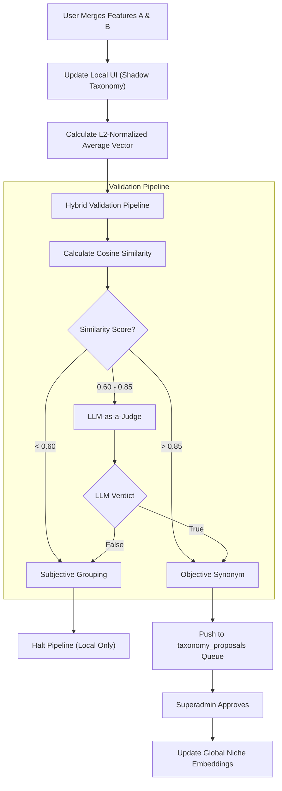

# Feature: Human-in-the-Loop (HITL) Taxonomy Merging

## Enhancement Summary

**Deepened on:** 2026-03-27
**Sections enhanced:** 2 (Local Vector Math, Cosine Similarity Thresholds)
**Research agents used:** `best-practices-researcher`

### Key Improvements

1. **Weighted Vector Averaging:** Upgraded basic vector averaging to a weighted model based on feature usage/validation counts to prevent semantic drift over time.
2. **Model-Aware Thresholds:** Refined the static cosine similarity thresholds to be model-configurable. `text-embedding-ada-002` clusters much tighter than `text-embedding-3`, making hardcoded >0.85 and <0.60 dangerous without context.
3. **Zero-Vector Safeguards:** Added mathematical edge case handling to prevent division-by-zero (`NaN`) errors when merged vectors perfectly cancel each other out.
4. **React 19 + Firestore Shadow State:** Resolved the "Split-Brain" `useFirebaseSync` issue by using React 19's `useOptimistic` combined with a Document-Level Shadow State (`evaluationStatus` flag) to prevent UI flickering during async background AI validations.
5. **Gemini 768D Fast-Path:** Aligned vector math with existing project learnings—enforcing Gemini 768D (not 1536D), synchronous `Float32Array` operations in Node (rejecting `SharedArrayBuffer` overhead), and `Math.log1p` V8 optimizations for precision.

## Overview

Founders analyzing competitors often encounter features that are functionally identical but named differently (e.g., "Email Sequences" vs "Drip Campaigns"). This feature allows users to manually merge these features, rename the resulting combined feature, and trigger a pipeline that validates the merge. Validated merges are applied locally to the user's project and queued for Superadmin approval to update the global niche feature taxonomy.

## Problem Statement

When the LLM parses Exa competitor websites, it generates a standardized JSON feature list, but naming inconsistencies persist across competitors. If users cannot merge these, the "Vector Uniqueness" score becomes artificially inflated by semantic duplicates. However, updating global vector embeddings blindly based on user merges risks polluting the taxonomy with highly subjective, project-specific feature groupings.

## Proposed Solution

1. **Local Shadow Taxonomy:** When a user merges features, the system creates a custom local feature (averaging the L2-normalized vectors of the merged features). This immediately cleans up their local UI and uniqueness scoring without altering global data.
2. **Hybrid Validation:** The system calculates the cosine similarity between the merged vectors. If borderline, an asynchronous LLM-as-a-Judge validates if they are functional synonyms in the specific niche.
3. **Superadmin Evaluation Queue:** Merges that pass the validation heuristic are pushed to a `taxonomy_proposals` collection. Superadmins can review and approve these to formally update the vector embedding dictionary for that submarket/niche.

## Technical Approach

### 1. UI & Local Merge Execution

- Update `src/components/ComputeMeter.tsx` (and related competitor analysis views) to allow multi-selecting features and clicking a "Merge" button.
- Prompt the user to provide a custom name for the new merged feature.
- **Local State Update:** Remove the old features from the project's feature list and insert the new merged feature.
- **Vector Math:** Calculate the new vector using $L_2$-normalized vector averaging: $V_{merged} = \frac{V_A + V_B}{2}$.

### Research Insights

**Best Practices:**

- Averaging vectors followed by strict L2-normalization is the standard, mathematically sound method for combining OpenAI embeddings because semantic meaning lives on the surface of the hypersphere.
- To prevent "semantic drift," you should use a **Weighted Average** (e.g., if Feature A is highly validated and Feature B is a new edge case, Feature A should dominate the new centroid).
- Mathematically, guard against vectors that perfectly cancel each other out (magnitude = `0`), which causes `NaN` division-by-zero during normalization.

**UI/UX Considerations (Automation Bias & Optimistic UI):**

- **Reversible Checkpoints:** Treat AI actions as "proposals" rather than "commits". Always offer a clear "Undo" or "Separate" action if the user doesn't like the proposed merge. Show a contextual diff (with the LLM's `reasoning`) if the AI proposes the merge.
- **React 19 & Firestore Split-Brain:** Avoid standard `useFirebaseSync` dropping concurrent updates. Use `useOptimistic` to instantly show the "Shadow Taxonomy" locally, and write to Firestore using `runTransaction` (not just `updateDoc`) setting `shadowTaxonomy` and `evaluationStatus: 'evaluating'`.
- **Progressive Disclosure & Visual States:** Do not overwhelm the user with a massive list. Hide/collapse "Approved" features by default. Expand "Evaluating" features.
  - _Evaluating:_ dashed borders, `text-slate-600`, loading spinner.
  - _Approved:_ solid green borders, `text-slate-900`, checkmark.
  - _Optimistic:_ Instantly show as Approved but at `opacity-60`. When Firestore `onSnapshot` returns the real state, transition to `opacity-100`.

**Technical Review Insights (TypeScript & React Performance):**

- **Strict Typing:** Ensure the optimistic state perfectly mirrors the server state type. Do not use `any`; use discriminated unions and strict type guards for the `ShadowTaxonomy` payload.
- **Double-Wrap Async Transitions:** React 19 loses transition context after an `await`. To prevent UI tearing, double-wrap: `startTransition(async () => { await mutate(); startTransition(() => { /* sync state updates */ }); });`
- **Memoization:** Heavily use `React.memo` with custom comparison functions for the feature list items to prevent re-render cascades when the global array updates.

**Implementation Details:**

```tsx
// React 19 Document-Level Shadow State Pattern with Nested Arrays
const [optimisticFeatures, dispatchOptimistic] = useOptimistic(
  currentDisplayFeatures,
  (current, action) => {
    if (action.type === "merge") {
      // Return new array replacing A and B with Merged, adding _optimistic flag
      return current.map(/* ... */);
    }
    return current;
  },
);

const handleUserMerge = (featuresToMerge: string[], customName: string) => {
  startTransition(async () => {
    dispatchOptimistic({ type: "merge", featuresToMerge, customName });
    try {
      const docRef = doc(db, "users", userId, "taxonomy");
      // Use runTransaction to prevent lost updates if multiple users merge simultaneously
      await runTransaction(db, async (transaction) => {
        const docSnap = await transaction.get(docRef);
        // ... apply merge logic deterministically ...
        transaction.update(docRef, {
          shadowTaxonomy: newTaxonomyState,
          evaluationStatus: "evaluating",
        });
      });
    } catch (err) {
      // React 19 automatically throws away the optimistic state if transition errors.
      toast.error("Failed to merge features. Please try again.");
    }
  });
};
```

```typescript
/**
 * Merges multiple vectors using an optional weighted average,
 * followed by strict L2 normalization.
 */
export function mergeVectors(
  vectors: number[][],
  weights?: number[],
): number[] {
  if (!vectors.length) return [];
  const dim = vectors[0].length;
  const merged = new Array(dim).fill(0);
  const w = weights || new Array(vectors.length).fill(1);

  // Step 1: Calculate the weighted sum of all vectors
  for (let i = 0; i < vectors.length; i++) {
    for (let j = 0; j < dim; j++) {
      merged[j] += vectors[i][j] * w[i];
    }
  }

  // Step 2: Calculate the L2 Norm (magnitude)
  let magnitudeSq = 0;
  for (let j = 0; j < dim; j++) {
    magnitudeSq += merged[j] * merged[j];
  }

  // Step 3: L2 Normalize (with zero-vector safeguard)
  if (magnitudeSq === 0) return merged; // Prevent division-by-zero

  const magnitude = Math.sqrt(magnitudeSq);
  for (let j = 0; j < dim; j++) {
    merged[j] /= magnitude;
  }
  return merged;
}
```

### 2. Hybrid Validation Pipeline

Create a new server endpoint (e.g., `src/server/taxonomyRoutes.ts` or add to `src/server/campaignRoutes.ts`) to handle the merge event asynchronously.

- **Step 1: Cosine Similarity Check**
  - Using existing logic in `test_vectors.js` / `test_vectors.cjs`, calculate the cosine similarity between the original features.
  - If `> threshold.objective`: High confidence objective synonym. Proceed to queue.
  - If `< threshold.subjective`: High confidence subjective grouping. Allow locally, but halt global pipeline.
- **Step 2: LLM-as-a-Judge (Fallback)**
  - If similarity is between the thresholds, dispatch a prompt to the LLM.
  - **Prompt Strategy (Chain of Thought + Few-Shot Alignment):** Instruct the LLM to differentiate between `OBJECTIVE_SYNONYM` (e.g., "Email Sequences" vs "Drip Campaigns") and `SUBJECTIVE_GROUPING` (e.g., "Email Sequences" vs "CRM").
  - Force the LLM to output `reasoning_feature_a`, `reasoning_feature_b`, and `boundary_analysis` BEFORE it returns its `relationship` and `confidence` score (to prevent hallucinated justifications).
  - If `OBJECTIVE_SYNONYM` and `confidence >= 0.90`, proceed to queue.
  - **Error Handling:** Use an exponential backoff loop for the LLM request. If it consistently fails or hits rate limits, safely fallback to `SUBJECTIVE_GROUPING` so it triggers the HITL review rather than an automated destruction merge.

### Research Insights

**Performance & Mathematical Considerations:**

- **Model-Specific Thresholds:** `text-embedding-ada-002` tends to tightly cluster vectors (random words average ~0.75 similarity). `text-embedding-3-small/large` spaces them out better (random words average ~0.40).
- If you use `ada-002`, `>0.85` is too loose (will false-positive) and `<0.60` is impossible (will false-negative). You'd need thresholds like `>0.92` (objective) and `<0.80` (subjective).
- If you use `text-embedding-3`, the initially proposed `>0.85` and `<0.60` are mathematically sensible and safe.
- **Actionable Takeaway:** Do not hardcode the 0.85 and 0.60 thresholds. Build a configuration object so you can migrate embedding models seamlessly without breaking the pipeline heuristics.
- **Gemini 768D Consistency:** NicheAI relies heavily on Gemini models for 768D embeddings over 1536D to save computational overhead. Ensure strict validation arrays assert `length === 768`.
- **Node.js Math:** Use V8 optimized `Float32Array` sequentially. IPC with `SharedArrayBuffer` is a proven anti-pattern in the current architecture. Pre-normalize embeddings during DB ingestion and simply run Inner Product (Dot Product) at validation time. Use `Math.log1p` when scoring to handle near-zero precision.

### 3. Superadmin Evaluation Queue

- Create a `taxonomy_proposals` Firestore collection.
- Schema: `{ originalFeatures: string[], mergedName: string, niche: string, similarityScore: number, llmValidated: boolean, status: 'pending' | 'approved' | 'rejected' }`.
- Build a simple Superadmin view to list pending proposals.
- Upon approval, the system updates the global niche vector dictionary, ensuring future users in this niche automatically benefit from the deduplication.

### Research Insights

**Dashboard UX & Global Cascade Strategies:**

- **Pre-Flight Impact Radius:** Do not allow a Superadmin to approve a merge blindly. Present a "What-If" score delta table showing the top 10 most affected existing projects and how their _Niche Viability Score_ shifts (e.g., dropping from viable into a tarpit).
- **Global Cascade via Market Shift:** Overwriting existing user project scores silently destroys trust. Use a "Market Shift" strategy:
  1. Immutable Baseline: A project's original score is tied to a specific taxonomy version for M&A auditability.
  2. Shadow Scoring: Calculate the `current_market_score` in the background.
  3. UI Alerts: If a global taxonomy merge causes a project's `current_market_score` to cross a threshold (into a Tarpit), trigger an in-app "Market Shift" notification to the founder.

**Technical Review Insights (Data Integrity & Scaling):**

- **Append-Only SCD Type 2 Taxonomy Rollback Model:** Never `DELETE` or `UPDATE` a taxonomy vector. When merging Node A and Node B, close the current record (`is_current: false`) and append a new document for the merged state within the _exact same atomic transaction_ to prevent temporal gaps. This preserves historical relationships and enables single-click un-merging.
- **Outbox Pattern for Scoring:** Don't compute the new scores synchronously on approval, as it causes "dual-write" anomalies if events fail. Write a scoring request event into an `outbox` subcollection _inside the exact same Firestore transaction_ that commits the taxonomy merge.
- **Node.js Worker Bottlenecks:** For the global cascade workers processing the outbox, implement a bounded worker pool (`piscina`) capped at `os.cpus().length - 1` to ensure the main thread can handle HTTP I/O. Use chunked event yielding (`setImmediate`) to prevent micro-task queue starvation during massive database updates.

## Acceptance Criteria

- [ ] Users can multi-select and merge features in the UI.
- [ ] Users can provide a custom name for the merged feature.
- [ ] Merged features are immediately reflected in the user's project (Shadow Taxonomy) using L2-normalized vector averaging.
- [ ] Hybrid validation (Cosine + LLM) evaluates the merge asynchronously.
- [ ] Validated merges generate a document in the `taxonomy_proposals` collection.
- [ ] Subjective merges (low similarity) are allowed locally but do not enter the evaluation queue.

## Mermaid Diagram


