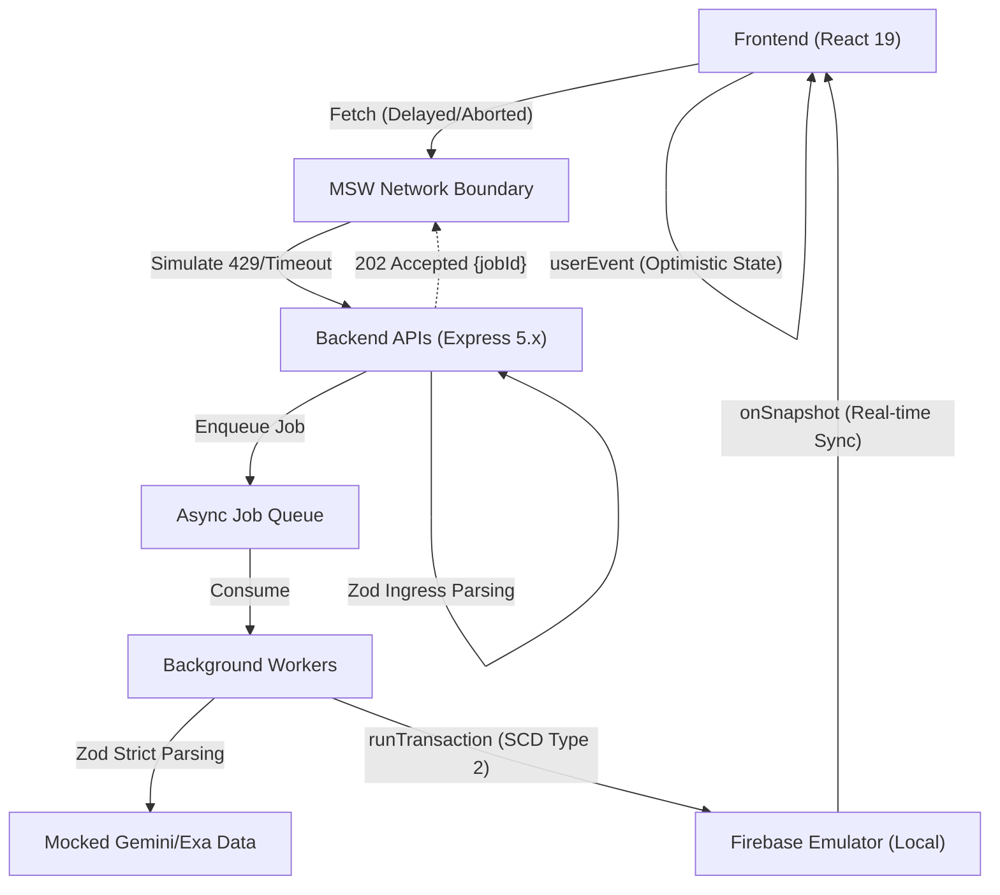

# P0 Intent-Based Testing Initiative

## Context & Objectives

The NicheAI platform is currently experiencing instability across UI transitions, ML orchestration (LLM timeouts/errors), and Firebase data synchronization. To stabilize the platform and align with NicheAI’s testing standards, we are rolling out a rigorous intent-based testing suite for all Critical Path (P0) features:

1. Tarpit Flywheel & Early Warning System
2. Market Intelligence & Competitor Discovery
3. Validation Arena & Fake Door Campaigns

## Architecture & Data Flow



## Deep Dive Implementation Details

### 1. Firebase Race Conditions & Teardown

To prevent the "Snapshot Beats the Fetch" anomaly (where `onSnapshot` updates the UI before the HTTP mutation resolves, causing stale closures to overwrite fresh data) and React 19 `useTransition` interruptions, we must use `msw` `delay()` combined with immediate Firebase Emulator writes.

**Strict Teardown Required (Vitest):**

```typescript
afterEach(async () => {
  server.resetHandlers();
  await fetch(
    "http://127.0.0.1:8080/emulator/v1/projects/demo-nicheai-test/databases/(default)/documents",
    { method: "DELETE" },
  );
});
afterAll(async () => {
  server.close();
  await terminate(env.db);
  await clearIndexedDbPersistence(env.db);
  await deleteApp(env.app); // Prevents Vitest hanging
});
```

### 2. Property-Based Testing (PBT) for LLM Streams

Because Server-Sent Events (SSE) from `gemini-3.1-pro` yield unpredictable chunk sizes, we use `fast-check` and `zod-fast-check` to mathematically prove our parsers never throw `SyntaxError` on partial data.

**Implementation Pattern:**

```typescript
// Generate Arbitrary from our schema
const llmEventArbitrary = ZodFastCheck().inputOf(LlmStreamEventSchema);

// Fuzz the parser with randomized chunks
fc.assert(
  fc.property(
    llmEventArbitrary,
    fc.array(fc.double({ min: 0.01, max: 0.99 })),
    (validEvent, splitRatios) => {
      // slice valid JSON into unpredictable chunks and ingest...
      expect(() => parser.ingest(chunk)).not.toThrow(SyntaxError);
      expect(() => LlmStreamEventSchema.parse(lastParsed)).not.toThrow();
    },
  ),
);
```

### 3. UX Intent Tests (RTL)

We test exactly what the user and screen reader perceive, avoiding implementation details like `useState` assertions.

- **Reverse Demo Hook**: Simulate a quick MSW response (`delay(150)`), assert the initial Risk Score renders, then assert the PQL `<dialog>` opens when clicking for a deep report.
- **Explainable States**: Assert the _absence_ of a generic `<Spinner />`. Use `vi.useFakeTimers()` to advance time and assert that sequential loading messages appear in an element with `aria-live="polite"`, while the container correctly uses `aria-busy="true"`.

### 4. CI/CD Stochastic Evaluation Layer

We separate deterministic unit tests (`*.test.ts`) from non-deterministic LLM tests (`*.eval.test.ts`).

- **Statistical Variance Baselines**: Execute LLM prompts $N$ times (e.g., $N=10$) to calculate the mean ($\mu$), standard deviation ($\sigma$), and 95% Confidence Interval. Fail the PR only if the lower bound drops below the baseline tolerance.
- **LLM-as-Judge Pairwise Preference**: Use `gemini-3.1-pro` (temp 0.1) as an automated judge to compare the Baseline Output against the Candidate Output in CI. Instead of absolute scoring, the judge returns `CANDIDATE_WINS`, `BASELINE_WINS`, or `TIE`, enforcing a non-regression rate (e.g., >= 90%).

## Phase Deliverables

### Phase 1: Tarpit Flywheel

**Focus**: The Reverse Demo Hook (PQL Gates) & Property-Based Zod Schema Parsing.

- Implement strict PBT stream parsing tests.
- Implement RTL intent tests for the Reverse Demo Hook scenario.

### Phase 2: Market Intelligence

**Focus**: Graceful Degradation via Stream Cancellation & Simulated Network Delays.

- Implement tests verifying `AbortController` cancellation degrades gracefully to partial data instead of a fatal error boundary.
- Implement "Snapshot Beats the Fetch" race condition testing.

### Phase 3: Validation Arena

**Focus**: Explainable States, Firebase Concurrency, & Real-time Subscriptions.

- Implement `vi.useFakeTimers()` tests for sequential `aria-live` loading states.
- Test React 19 `startTransition` interruptions by concurrent Firebase `onSnapshot` updates.

### Phase 4: CI/CD Stochastic Eval

**Focus**: Pre-Merge Gating for Non-Deterministic Pipelines.

- Create the Stochastic Evaluation Layer (`measureVariance` and `evaluatePairwise`).
- Integrate into GitHub Actions as a secondary gating check after unit tests.
