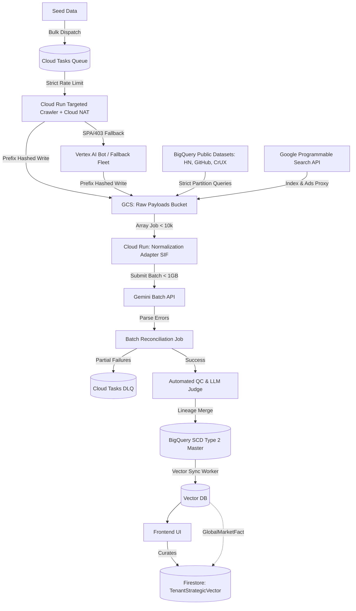

---

## title: feat: Hyper-Scale SaaS Data Moat Pipeline - Elite Sources

type: feat
status: active
date: 2026-04-04

# feat: Hyper-Scale SaaS Data Moat Pipeline - Elite Sources

## Overview

To build the world's most exhaustive foundational SaaS dataset and provide "Elite VC-Grade" intelligence to accelerator startups, we are radically overhauling our data ingestion architecture. The pipeline must synthesize high-signal, non-obvious metrics (dynamic traction, hiring intent, dark social sentiment, pricing shifts) without relying on expensive $50k/yr enterprise API licenses.

This plan introduces a **Serverless Extraction & LLM Synthesis (SELS)** architecture using a **Synthetic Signal Proxy Pattern**. It replaces basic directory crawling with GCP-native proxies: BigQuery Public Datasets (CrUX, GitHub Archive, Hacker News), event-driven Cloud Run scrapers via Cloud NAT, and Vertex AI Search. All heterogeneous data is processed via a Normalization Adapter Layer, chunked into `.jsonl`, and submitted to the **Gemini Batch API** for massive cost savings. It introduces the `TenantStrategicVector` ontology to maximize the PLG "Endowment Effect."

## Problem Frame

- **Noise vs. Signal:** Basic firmographics (total funding, headcount) and generic directory scraping fail to reveal true GTM strategies or hidden tarpits.
- **Enterprise API Costs:** Subscribing to Earnest, Autobound, SpyFu, and Common Room would cost $100k+/year, violating our capital-efficient GCP-credit-only constraint.
- **Speed & Scale:** Synchronous scraping and LLM extraction for 100,000 domains will instantly trigger `429 Too Many Requests` and burn massive compute.
- **Data Heterogeneity:** Ingesting HTML, JSON from HN, and BQ SQL results requires a standardized processing pipeline to avoid spaghetti code.
- **Endowment Effect:** If the data feels like a generic database, founders will churn. It must feel like a proprietary, personalized strategic asset.

## Requirements Trace

- R1. **Massive Seed & Decoupled Queue:** Ingest 100k+ URLs via a decoupled Firestore + Pub/Sub architecture, avoiding Cloud SQL/BigQuery locking issues during high-frequency status updates (`QUEUED`, `STATIC_FETCHED`, etc.).
- R2. **GCP Native Proxy Stack (Elite Sources):** Synthesize traction (CrUX), developer sentiment (GitHub/HN), and pricing shifts using BigQuery federated queries and Cloud Run web scraping. Explicitly reject paid enterprise APIs.
- R3. **High-Speed Crawling & IP Rotation:** Deploy HTTP crawlers on event-driven Cloud Run. Route outbound traffic via Cloud NAT with a static IP pool to avoid immediate bot-bans. Use prefix hashing for GCS raw payload buckets (`gs://lake/raw-payloads/`) to prevent hotspotting.
- R4. **Batch Extraction & Reconciliation:** Implement a Normalization Adapter Layer on Cloud Run to convert payloads to a Standardized Internal Format (SIF). Chunk SIFs into `.jsonl` and submit to the Gemini Batch API. A Batch Reconciliation Job must handle partial failures and route them to a synchronous DLQ.
- R5. **Automated QC & LLM-as-a-Judge:** Perform random 1% audits using `gemini-3.1-pro-preview` with a strict rubric, enforcing a "Negative Feature Penalty" for hallucinations. Quarantine bad payloads.
- R6. **The Market Context Graph & Vector Sync:** Maintain SCD Type 2 lineage in BigQuery. Run a daily Vector Sync Worker to bulk upsert active records and explicitly tombstone deleted entities in the Vector DB. Store `TenantStrategicVector` edges in Firestore to link `GlobalMarketFact` to the user's `TenantIdea`.

## Scope Boundaries

- We will explicitly avoid GCP Dataflow (Apache Beam), utilizing array-based **Cloud Run Jobs** for all parallel transformation tasks to reject infrastructure bloat.
- We will strictly avoid integrating third-party paid APIs (e.g., Firecrawl Cloud, Apify) in favor of self-hosted/GCP-native alternatives like Vertex AI Search (`Google-CloudVertexBot`).

## Context & Research

### Relevant Code and Patterns

- `src/server/scoringRoutes.ts`: Current Exa retrieval and embedding logic.
- `src/server/workers/marketIntelligenceWorker.ts`: Cloud Tasks worker for background enrichment.
- `AGENTS.md`: Mandates in-house implementations (Gemini Flash), the Claim Check pattern for payloads >100KB, avoiding infrastructure bloat, and the "Binary Triage" mindset.

## Key Technical Decisions

- **Decision:** Synthetic Signal Proxy Pattern.
  **Rationale:** Simulates $100k/yr enterprise data APIs using cheap/free GCP proxies (BigQuery public datasets, scheduled Cloud Run scrapers), enabling VC-grade insights using only GCP credits.
- **Decision:** Cloud Tasks Queue with Claim Check.
  **Rationale:** Replaces Pub/Sub + Firestore. Firestore collections with `status="QUEUED"` for 100k+ records cause index hotspotting and write bottlenecks. Cloud Tasks natively provides explicit concurrency controls, rate limiting, and dispatch rules perfectly suited for HTTP scraping fleets.
- **Decision:** Cloud NAT via Direct VPC Egress.
  **Rationale:** Allows the serverless Cloud Run fleet to proxy requests through a pool of 50+ static IPs without provisioning legacy Serverless VPC Access connectors (which scale poorly and increase costs).
- **Decision:** Native Partitioned Queries (BigQuery).
  **Rationale:** Replaces expensive enterprise data APIs by querying massive public datasets (CrUX, GitHub Archive, HN). We strictly enforce `_PARTITIONTIME` filters to prevent scanning terabytes of data and blowing out GCP budgets.
- **Decision:** Normalization Adapter Layer & SIF.
  **Rationale:** Converts heterogeneous raw payloads into a unified Standardized Internal Format before hitting Gemini. Cloud Run Jobs are used, strictly bounded to max 10,000 tasks per execution to align with GCP limits.
- **Decision:** Batch API with Strict Chunking & Reconciliation.
  **Rationale:** Cuts costs by 50%. The SIF payloads are chunked into `.jsonl` files (strictly <50,000 requests and <1GB per file). A 'Batch Reconciliation' job merges successes and routes partial failures to a DLQ.
- **Decision:** Real-Time Synchronous Fallback.
  **Rationale:** Resolves the Time-to-Value (TTV) delay of the Batch API (24+ hr latency). If a new user searches for a hyper-niche not in the 100k seed list, the system executes a real-time synchronous fallback (Exa -> Gemini Flash) to preserve the immediate "wow" moment.
- **Decision:** The Market Context Graph & Shareable Artifacts.
  **Rationale:** Maximizes PLG. Separates immutable `GlobalMarketFact`s from the user's personalized `TenantStrategicVector`. To drive acquisition, this curated intelligence powers external, shareable artifacts (public competitive teardowns).
- **Decision:** Vector Sync Worker with Explicit Tombstoning.
  **Rationale:** Completely decouples analytical BigQuery storage from the operational Vector DB. The daily sync worker guarantees state parity and explicitly handles `DELETE` commands for deprecated companies.

## Open Questions

### Deferred to Implementation

- Optimal chunk sizing for the Gemini Batch API (e.g., 5k vs 10k lines) to minimize DLQ routing overhead while maximizing throughput.
- Exact heuristic thresholds for the Negative Feature Penalty during LLM-as-a-Judge QC.

## Implementation Units

- **Unit 1: Massive Seed & Cloud Tasks Queue**
  **Goal:** Ingest 100k+ SaaS domains on Day 1 and track state strictly using explicit concurrency controls.
  **Requirements:** R1
  **Dependencies:** None
  **Files:**
  - Create: `scripts/seed-domains.ts`
    **Approach:** Parse XML sitemaps and Crunchbase canonical URLs. Dispatch URLs into a master **Cloud Tasks** queue (abandoning Pub/Sub + Firestore `QUEUED` antipatterns to prevent index hotspotting). Implement strict rate limiting and explicit backpressure rules for the HTTP scraping fleet.

- **Unit 2: Tiered Crawling Fleet & Proxy Stack**
  **Goal:** Gather raw payloads using GCP-native proxies and IP rotation.
  **Requirements:** R2, R3
  **Dependencies:** Unit 1
  **Files:**
  - Create: `src/server/workers/staticCrawlerWorker.ts`
    **Approach:** Deploy an event-driven HTTP crawler on Cloud Run. Configure **Direct VPC Egress** and Cloud NAT for a static IP pool, explicitly avoiding legacy Serverless VPC Access connectors. Dump raw payloads to `gs://lake/raw-payloads/` using prefix hashing. Set up **Native Partitioned Queries** in BigQuery for `githubarchive`, `hacker_news`, and `CrUX`, enforcing strict `_PARTITIONTIME` filters to prevent massive query costs. Implement a **Real-Time Synchronous Fallback** path for unseeded hyper-niches to preserve TTV.

- **Unit 3: Cloud Run Array Jobs & Gemini Batch Extraction**
  **Goal:** Process heterogeneous data cheaply and handle partial failures while respecting GCP execution limits.
  **Requirements:** R4
  **Dependencies:** Unit 2
  **Files:**
  - Create: `src/server/workers/normalizationAdapterJob.ts`
  - Create: `src/server/workers/batchReconciliationJob.ts`
    **Approach:** Implement the Normalization Adapter Layer in Cloud Run to convert payloads to SIF. Enforce a maximum of 10,000 tasks per Cloud Run execution. Chunk SIFs into `.jsonl` files (strictly under 50,000 requests and 1GB per file) and submit to the Gemini Batch API. The Batch Reconciliation Job parses error logs, merges successes to GCS Silver Lake, and routes partial failures to a synchronous DLQ.

- **Unit 4: Automated QC, Auditing & The Market Context Graph**
  **Goal:** Guarantee enterprise-grade data quality and establish the PLG ontology via Endowment Effect UI.
  **Requirements:** R5, R6
  **Dependencies:** Unit 3
  **Files:**
  - Create: `src/server/workers/auditWorker.ts`
  - Modify: `src/components/TrustBuilderScreen.tsx`
  - Modify: `src/components/CompetitorDiscoveryModal.tsx`
    **Approach:** Run BigQuery statistical anomaly detection. Randomly sample 1% of output for strict `gemini-3.1-pro-preview` evaluation (Negative Feature Penalty). Implement the `TenantStrategicVector` edge schema in Firestore. Scope the **User-Facing Curation UI** where founders invest time to refine their proprietary threat model. Define how this curated intelligence generates external, **shareable artifacts** (public competitive teardowns) to drive the PLG acquisition loop.

- **Unit 5: BigQuery Lineage & Vector Sync**
  **Goal:** Maintain strict provenance and operational sync.
  **Requirements:** R6
  **Dependencies:** Unit 4
  **Files:**
  - Create: `src/server/workers/vectorSyncWorker.ts`
  - Modify: `src/server/scoringRoutes.ts`
    **Approach:** Daily `MERGE` query updates the SCD Type 2 BigQuery table tracking lineage. The `vectorSyncWorker` pushes validated changes to the Vector DB, explicitly handling tombstoning. UI queries the Vector DB directly.

## System-Wide Impact

- **Time to Market:** The foundational dataset goes from an abstract long-term goal to a tangible asset built in under a week.
- **Cost Efficiency:** Using Cloud Run Jobs, Cloud NAT, and the Batch API slashes compute, proxy, and LLM costs, keeping out-of-pocket spend at $0.
- **Data Quality:** The LLM-as-a-Judge audit ensures the moat is built on verifiable truth, not LLM hallucinations.
- **PLG Lock-in:** The `TenantStrategicVector` graph creates a highly personalized asset that founders cannot abandon.

## Architecture Flow

## Risks & Dependencies

| Risk               | Mitigation                                                                                                                                                                                                |
| ------------------ | --------------------------------------------------------------------------------------------------------------------------------------------------------------------------------------------------------- |
| IP Reputation Burn | Even static crawlers will get blocked if hitting 1,000 req/sec from a single IP. Utilize Cloud Run with Cloud NAT to provide static IP rotation without maintaining fleet infrastructure.                 |
| Proxy Data Drift   | Synthetic signals from Reddit/GitHub might not perfectly correlate with actual financial metrics. Continually benchmark against internal ML validation heuristics.                                        |
| Batch API Latency  | Batch APIs have variable turnaround times (sometimes 24+ hours). Ensure the pipeline is fully decoupled and asynchronous, relying on Cloud Storage triggers to resume processing when the batch finishes. |
| Schema Evolution   | Heterogeneous sources will evolve over time. Enforce strict Zod schemas at the Normalization Adapter Boundary and route parsing failures to the DLQ.                                                      |

## Sources & References

- **Origin document:** Conversational brainstorming sessions, Elite Alternative Data research.
