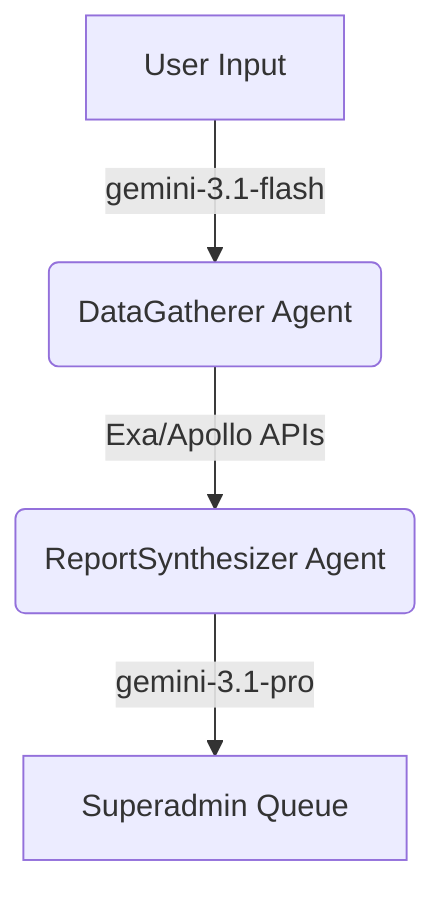

# OpenSpec Plan: Superadmin Pipeline (Lean MLP)

**Target File:** `openspec/plans/YYYY-MM-DD-superadmin-pipeline-gtm.md`

## 1. Executive Summary

This plan implements the "Lean MLP" asynchronous Go-To-Market strategy. Following accelerator best practices (Martyna intervention), we cut the architectural bloat of a 5-agent DAG and an iterative chat dashboard. Instead, we use a rapid Two-Phase Fetch to hook users, a simplified 2-agent pipeline for research, a raw Markdown editor for quick superadmin approvals, and a rigid Firebase Auth gate to securely deliver the report and capture the user as a Product-Qualified Lead (PQL).

## 2. Core Features & UX Flow

### A. The "Two-Phase Fetch" (Combating Dopamine Drop & Spam Risk)

- **The Input:** Founder submits their startup idea at `/roast-my-niche`.
- **Phase 1 (Synchronous Surface Roast):** To prevent the "12-hour dopamine void," the UI immediately displays a 3-bullet-point synchronous "Surface Roast" generated via `gemini-3.1-flash`. This proves instant intelligence.
- **Phase 2 (The Handoff):** The deep-dive market intelligence is gated behind an email capture. The UI explicitly instructs the user: _"Add hello@nicheai.com to your contacts. Our AI pipeline is executing deep competitor discovery. We will email you when it's ready."_

### B. The Lean 2-Agent Pipeline (Backend)

We avoid compounding LLM error rates by collapsing the 5-agent architecture down to a focused 2-agent workflow.

1.  **DataGatherer Agent:** Extracts the core intent and queries Exa/Apollo to pull real competitor and market data.
2.  **ReportSynthesizer Agent:** A single high-context `gemini-3.1-pro` call that performs the Tarpit Evaluation, Moat Detection, and final synthesis in one step, using the Exa/Apollo data as strict grounding context.

### C. The Superadmin Dashboard & Manual Edit

- **The Queue (`/admin/pending-roasts`):** A secure UI where the NicheAI founder reviews pending reports. To prevent a DoS attack on the founder, the queue pauses new frontend submissions if pending reports exceed 50.
- **Data Lineage & Edit View:** The dashboard displays the raw user input, the Exa/Apollo sources, and a raw `<textarea>` pre-populated with the Synthesizer's Markdown draft.
- **Manual Refinement:** No internal AI chat. The Wizard manually edits the markdown to fix typos, tweak tone, or add a specific human insight, ensuring < 5 minute turnaround per report.

### D. The Secure PQL Delivery (Firebase Auth Gate)

- **Approval & Dispatch:** The Superadmin clicks "Approve," dispatching a transactional email.
- **The Gate:** The email does _not_ contain an unguessable link. It says: _"Your report is ready. Log in to your NicheAI dashboard to view your market gaps."_
- **The Conversion:** The user authenticates (Firebase Auth), securing their proprietary data and officially converting them into a PQL for future retention/monetization loops.

## 3. Technical Implementation Details

- **Models & Prompting:**
  - `gemini-3.1-pro` for deep Report Synthesis (high reasoning).
  - `gemini-3.1-flash` for the synchronous Surface Roast and DataGatherer agent.
- **Database Schema (Firestore):**
  - `leads`: Captures input and email.
  - `pending_reports`: Stores the pipeline's draft Markdown, Exa/Apollo lineage data, and approval status (`pending`, `approved`, `rejected`).
- **Superadmin Identity:** Leverage existing custom JWT tokens (`{ isSuperadmin: true }`).

## 4. Success Criteria

- The "Two-Phase Fetch" correctly displays immediate surface value.
- The 2-agent pipeline executes successfully and populates the `<textarea>`.
- Superadmin can edit and approve the draft rapidly.
- Users are forced through Firebase Auth to view their final report, securing data and capturing PQLs.
