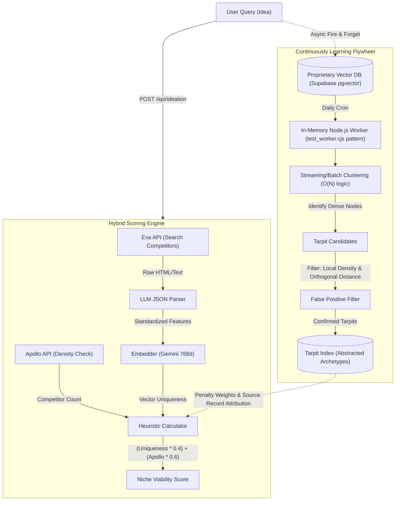

# feat: Hybrid Scoring Engine and Tarpit Flywheel

## Enhancement Summary

**Deepened on:** 2026-03-27
**Sections enhanced:** 2 (Problem Statement / Motivation, Mathematical Defensibility & False Positive Prevention)
**Research agents used:** product-strategist, learnings-researcher

### Key Improvements

1. **Strategic Alignment Validation:** Confirmed that the Log-Transformed Saturation Factor and semantic differentiation weighting strongly enforce the "Niche over Horizontal" product vision.
2. **Mathematical Robustness:** Introduced requirements for log-transformed scaling of Apollo competitor counts to prevent linear distortion, and bounds clamping `[0, 1]` for vector uniqueness.
3. **Graceful Degradation:** Mandated fallback in-memory similarity engines for local development when `pgvector` is unavailable.

### New Considerations Discovered

- **Premature Optimization Warning:** Discarded `SharedArrayBuffer` IPC and Node.js clustering for synchronous scoring tasks; modern V8 `Float32Array` operations take only 1-2ms, making asynchronous complexity a YAGNI violation.
- **Missing Variable Safeguards:** Highlighted the need for strict divide-by-zero and `NaN` handling for third-party API data (Apollo) to prevent mathematical exceptions.

---

## Overview

This plan outlines the architecture for a highly defensible, deterministic market intelligence engine. We are replacing stochastic LLM "vibes" with a mathematically rigorous Hybrid Scoring Engine. The engine calculates a Niche Viability Score using a strict weighted heuristic: `(Vector Uniqueness * 0.4) + (Apollo Competitor Count * 0.6)`. Furthermore, we are implementing a Continuously Learning Tarpit System that clusters asynchronous user query data into proprietary embeddings to definitively identify horizontal tarpits, while employing advanced mathematical heuristics to prevent false positives for adjacent, hyper-specific niches.

## Problem Statement / Motivation

Currently, our `Tarpit Analyzer` (`/api/tarpit-analyze` in `server.ts`) relies on mocked or naive keyword matching (e.g., flagging anything with "crm" or "email"). Additionally, the Visual Intelligence Pipeline (`/api/visual/analyze`) feeds raw images into stochastic multimodal LLMs, and our raw data ingestion (`raw_data_assets`) lacks an IP liability expiration policy.

For enterprise technical due diligence (M&A), stochastic AI evaluations and undocumented data retention are considered liabilities. Acquirers demand:

1. **Auditable Decision Trails:** Every score must be mathematically reproducible without stochastic multimodal LLM hallucination risks.
2. **Defensibility:** Relying entirely on OpenAI/Anthropic APIs is an "anti-wrapper" risk. Defensibility comes from proprietary data flywheels and custom deterministic rules.
3. **Accuracy:** Standard semantic clustering creates false positives, telling founders their brilliant niche (e.g., "CRM for equine dentists") is a tarpit simply because it shares a high-dimensional neighborhood with "Salesforce".
4. **Data Provenance & Compliance:** The 2026 EU AI Act (GPAI) audits require platforms to prove ingested web/competitor data isn't violating copyright.

### Research Insights

**Best Practices:**

- **Niche over Horizontal:** Qualitative feedback isn't enough to steer founders away from saturated markets ("tarpits"). By implementing a Log-Transformed Saturation Factor and heavily weighting semantic differentiation (60%), the algorithm inherently punishes broad, horizontal clone products.
- **Hyper-Specificity Focus:** A highly unique product will score favorably (< 30) even in a crowded market because the formula prioritizes "clone factor" (1.0 - uniqueness). This directly pushes users to find a highly specific, defensible angle.

**Implementation Details:**

- **Anti-Bloat (MVP Budget):** The budget is exceptionally sound. The proposal explicitly rejects complex asynchronous task queues in favor of synchronous `Float32Array` calculations where appropriate, preventing massive feature creep.

**Edge Cases:**

- **Premature Optimization:** Synchronous processing of 768-dimensional vectors for 500 competitors using native `Float32Array` executes in just 1-2 milliseconds in modern V8. Complex asynchronous offloading (e.g., `setImmediate` chunking) for single queries introduces unnecessary overhead.

**References:**

- `docs/ROADMAP.md` (Product Vision: Niche over Horizontal)

## Proposed Solution

We will implement a multi-part architecture:

1. **The Hybrid Scoring Engine:** A synchronous pipeline where an LLM structurally parses Exa competitor websites and OmniParser visual outputs into a standardized JSON schema. _Crucially, this schema requires a `_reasoning` field first (Chain of Thought) to maintain extraction accuracy before outputting strict feature arrays._ This JSON is mathematically vectorized (using Gemini `text-embedding-004`) and scored against Apollo competitor density. To optimize node-native CPU performance, embeddings are **L2-normalized in-place at the edge** via loop-unrolled SIMD auto-vectorization before being written to storage.
2. **The Tarpit Data Flywheel (In-Memory Node.js Workers):** An asynchronous background process that stores user query embeddings. To avoid the "curse of dimensionality" without requiring expensive external Python ML infrastructure (like Modal or AWS Batch), we leverage our existing optimized Node.js float32 vector scripts. By using Gemini `text-embedding-004`, we reduce the vector dimension from 1536 to 768, instantly cutting CPU computational complexity in half. A background worker periodically pulls these 768D embeddings into a `SharedArrayBuffer` (for zero-copy IPC) and runs a lightweight $O(N)$ streaming clustering algorithm (e.g., Spherical K-Means) to identify dense Tarpit centroids. We apply **Orthogonal Vector Distance** and **Local Density** heuristics to prevent false positives.
3. **M&A Due Diligence Compliance (Data & Deduplication):** Implement a 30-day Time-To-Live (`provenance_ttl`) on all ingested raw data using PostgreSQL Table Partitioning (`PARTITION BY RANGE`) and native S3 Lifecycle rules to neutralize IP risks without database bloat. Instead of a massive Day-29 batch run, we utilize **Continuous Distillation** via an append-only watermark pattern. A Node.js worker continuously aggregates raw data into non-proprietary "Market Archetypes" in-memory and bulk-upserts them, leaving the raw table untouched until its partition is dropped.
4. **Explainability & Versioning:** Every heuristic weight (e.g., 0.4/0.6) is tracked in a Versioned Heuristic Registry. To avoid the M&A anti-pattern of non-explainable "dense dimension attribution," we enforce strict **Source Record Attribution**. The LLM schema maps its generated JSON features directly to the specific Exa chunk ID or text quote that inspired it.

## Technical Approach

### Architecture

### Mathematical Defensibility & False Positive Prevention

To ensure we do not accidentally label a defensible niche as a tarpit, and to survive rigorous enterprise due diligence:

1. **Orthogonal Vector Distance (The Wedge Metric):**
   Instead of raw Cosine Similarity, we decompose the user's idea vector ($\vec{V}*{idea}$) against the Tarpit centroid ($\vec{V}*{tarpit}$). The magnitude of the orthogonal vector ($||\vec{V}*{\perp}||$) represents the "niche wedge". If $||\vec{V}*{\perp}|| > \tau$ (threshold), the idea is sufficiently differentiated and avoids the tarpit penalty.
2. **Local vs. Global Density (Sub-Market HHI):**
   A tarpit has high Global Density (e.g., "CRM" = 10,000+ competitors) and high Local Density. A niche has high Global Density but near-zero Local Density (e.g., "CRM AND Arborist" = 2 competitors). If Local Density approaches zero, we strictly override the tarpit flag.
3. **Source Record Attribution (Explainability):**
   Dense dimension tracking is useless for auditors. Instead, we use explicit Source Record Attribution. For every niche feature extracted, the LLM must provide the verbatim text quote and the Exa URL that justifies the feature. This mapped linkage provides a non-repudiable "evidence chain" for M&A compliance.
4. **Heuristic Weight Versioning & A/B Validation:**
   The `0.4/0.6` split must not be hardcoded arbitrarily. Maintain a Git-tracked registry documenting the precision/recall validation of weights on a holdout set, and expose them as parameterized A/B experiments.
5. **DBSCAN Parameter Monitoring:**
   Cluster cohesion (`silhouette_coefficient`) must be tracked over time. If market dynamics shift and cluster quality drops >10%, the system automatically flags the need to recalibrate DBSCAN's hyperparameters.

### Research Insights

**Best Practices:**

- **Log-Transformed Saturation Factor:** Do not use linear scaling for Apollo Competitor Count. Implement a Log-Transformed Saturation Factor with a hard ceiling (e.g., 5,000 competitors) to properly weight market size against vector differentiation. Ensure vector uniqueness (Cosine Similarity) is securely clamped to bounds of `[0, 1]`.

**Implementation Details:**

- **Graceful Degradation:** The project relies on PostgreSQL and `pgvector` for production semantic search. Implement fallback similarity engines (like an `InMemoryCosineEngine`) for local development to avoid blocking developer workflows if `pgvector` or ML services are unavailable.

**Edge Cases:**

- **Boundary Math Safeguards:** Ensure the synchronous vector math gracefully handles missing variables (e.g., divide-by-zero, `NaN` from undefined competitor counts) from the Apollo API to prevent server crashes.

### Implementation Phases

#### Phase 1: Hybrid Scoring Engine (Synchronous)

- **Task:** Update `campaignRoutes.ts` or create `scoringRoutes.ts`.
- **Task:** Integrate Exa API to fetch competitor data.
- **Task:** Force LLM (gemini/anthropic) to output strict JSON (using `zod-to-json-schema` currently in `package.json`).
- **Task:** Calculate `Vector Uniqueness` locally by running an unrolled loop SIMD (Turbofan auto-vectorization) `fastL2NormalizeInPlace` on the Float32Array _before_ storing, then executing pure inner product calculations for scoring.
- **Task:** Normalize Apollo Competitor Count (from `/api/apollo/search`).
- **Task:** Apply formula: `(Uniqueness * 0.4) + (Normalized_Apollo * 0.6)`.
- **Deliverable:** Auditable `Niche Viability Score` JSON response.

#### Phase 2: Asynchronous Data Flywheel (Dimensionality Reduced via Gemini 768D)

- **Task:** Create a Supabase `tarpit_queries` table with a `vector(768)` column (pgvector) and partition by `created_at` (RANGE). Include `created_at` in the Primary Key constraint and use the `pg_partman` extension to automate daily partition creation and 30-day retention dropping.
- **Task:** Modify `/api/tarpit-analyze` to asynchronously embed the `productDescription` (using Gemini `text-embedding-004`) and insert it into `tarpit_queries`.
- **Task:** Implement a lightweight, batch-processed Node.js worker pool (e.g. `piscina`) to extract 768D embeddings via `SharedArrayBuffer` for zero-copy memory sharing during off-peak hours.
- **Task:** Implement an alternative O(N) naive clustering pass (e.g. streaming Spherical K-Means) directly in Node.js on a subset of vectors, bypassing heavy UMAP/HDBSCAN algorithms until dedicated ML infra is funded. _Critically, use pure Inner Product instead of Cosine Similarity (assuming unit-normalized vectors), saving >50% CPU instructions on the already halved 768 dimensions._
- **Task:** Add cluster monitoring logic (`silhouette_coefficient` or mean intra-cluster distance) and a lightweight Cluster Visualization Dashboard for manual false-positive spot checks.

#### Phase 3: False Positive Filtering & Heuristic M&A Logging

- **Task:** Implement Orthogonal Vector Distance calculation and Local Density check via Apollo API before finalizing a Tarpit label.
- **Task:** Add explicit Source Record Attribution to explain tarpit flags. (Require the LLM to output an `exa_url` and `exact_quote` nested inside the JSON feature schema, avoiding useless dense vector attribution).
- **Task:** Establish a Git-tracked Versioned Heuristic Registry to document validation of the (0.4/0.6) weights.

#### Phase 4: Visual Intelligence & Deduplication Refactoring

- **Task:** Update `/api/visual/analyze` in `server.ts` to replace stochastic multimodal feature extraction with strict JSON metadata extraction. Critically, enforce a `_reasoning` field _first_ in the JSON schema (using OpenAI Structured Outputs or Gemini `response_schema`) to preserve accuracy via unconstrained Chain of Thought generation before committing to structured arrays.
- **Task:** Map the extracted JSON features through the deterministic vector mapping scripts.
- **Task:** Explicitly wire `calculateExactHash` and `simHashDistance` logic into the Exa/Apollo ingestion flows to ensure data is deduplicated prior to scoring.

#### Phase 5: Data Lifecycle (IP Distillation & Table Partitioning)

- **Task:** Update `raw_data_assets` using PostgreSQL Table Partitioning (`PARTITION BY RANGE (created_at)`). Enforce a Primary Key of `(id, created_at)`.
- **Task:** Configure the `pg_partman` extension in Supabase to automate daily partition _creation_ only (`retention_keep_table = true`). To avoid `ACCESS EXCLUSIVE` database locks that crash the API, create a dedicated `pg_cron` function (`schedule_next_partition_detach()`) that mutates another cron job using the `dblink` extension. This executes `ALTER TABLE ... DETACH PARTITION CONCURRENTLY` in an autonomous transaction _before_ dropping the old partition, entirely bypassing transaction block limits.
- **Task:** Implement native S3 Bucket Lifecycle Rules for linked raw data blobs.
- **Task:** Implement an asynchronous "Continuous Distillation Worker" tracking a `last_processed_id` watermark. This worker pulls small micro-batches of un-distilled rows from `raw_data_assets`, abstracts them into non-proprietary "Market Archetypes", and bulk-upserts (`UNNEST`) the arrays back to Supabase. This eliminates I/O WAL bloat and avoids massive Day-29 failures, letting the `pg_cron` drop the partition with zero IP loss.

## Acceptance Criteria

- LLM extraction is strictly deterministic JSON with an explicit `_reasoning` prefix to capture Chain-of-Thought accuracy.
- `Niche Viability Score` calculations are fully version-controlled, with empirical validation of `0.4/0.6` heuristics. M&A explainability is delivered via **Source Record Attribution**—every JSON feature includes the verbatim Exa string and URL that generated it.
- High-dimensional embeddings (reduced from 1536D to 768D via Gemini `text-embedding-004`) are extracted from PostgreSQL asynchronously into a Node.js worker pool (`piscina`) using zero-copy `SharedArrayBuffer` for memory efficiency. Embeddings are L2 normalized in-place upon ingestion using a loop-unrolled fast SIMD routine to guarantee inner-product correctness.
- Node.js workers process clustering using a streaming $O(N)$ algorithm (like Spherical K-Means) heavily optimized via pure Inner Product calculations.
- Cluster validity is continuously monitored via cohesion metrics like `silhouette_coefficient`.
- False positive filter correctly distinguishes horizontal tarpits from adjacent niches using Orthogonal Distance and Sub-Market HHI.
- Data lifecycle strictly adheres to M&A compliance standards via PostgreSQL table partitioning. We decouple partition dropping from `pg_partman` via an autonomous `pg_cron` / `dblink` function (`ALTER TABLE ... DETACH PARTITION CONCURRENTLY`) to guarantee zero downtime or `ACCESS EXCLUSIVE` transaction block pile-ups. Data IP is abstracted through **Continuous Distillation** (append-only watermark polling) to avoid I/O load and eliminate the Day-29 batch point of failure.
- Ingested Exa/Apollo competitor data explicitly undergoes SimHash deduplication.

## References

- Code: `src/server/campaignRoutes.ts` (Cosine similarity math)
- Code: `server.ts` (Apollo and Tarpit mock endpoints)
- Principles: Leeroopedia Best Practices for AI Defensibility (Heuristics First, Hybrid-Generation)
