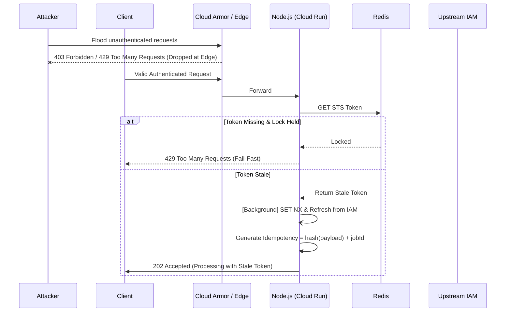

# RFC v19: Resilient LangSmith Multiplexing Protocol

**Date:** 2026-04-11
**Status:** Proposed (Replaces v18)
**Component:** Backend Core / LangSmith Multiplexing

---

## 1. Executive Summary

RFC v18 of the LangSmith Multiplexing Protocol exhibited three critical distributed systems and security flaws that compromised system stability: Unauthenticated Auth-Layer DoS, Fleet Starvation via polling loops, and State Corruption via invariant idempotency keys.

RFC v19 proposes a definitive paradigm shift towards a fail-fast, defense-in-depth architecture. By pushing rate limiting to the infrastructure edge (WAF), replacing synchronous lock polling with Stale-While-Revalidate (SWR) semantics, and implementing Payload-Aware Idempotency Keys, this design guarantees high availability, strict data integrity, and predictable Cloud Run concurrency management.

## 2. Background & Problem Statement (v18 Fatal Flaws)

Post-mortem analysis of the v18 architecture revealed the following fatal flaws:

1. **Unauthenticated Auth-Layer DoS via Ingress:**
   _Issue:_ Synchronous Redis rate-limiting was executed at the Node.js API Gateway _before_ complete authentication.
   _Impact:_ Malicious actors could exhaust the Redis connection pool using high-volume unauthenticated requests, preventing legitimate traffic from acquiring connections.
2. **Resource Exhaustion / Fleet Starvation:**
   _Issue:_ The distributed Redis lock (`SET NX`) utilized a while-loop polling mechanism for cache misses.
   _Impact:_ If the upstream IAM API experienced latency, all Cloud Run containers would exhaust their concurrency limits waiting in the sleep/poll loop, starving the entire fleet of available worker threads (Event Loop Starvation).
3. **State Corruption (Payload Mutation against Invariant Keys):**
   _Issue:_ Idempotency keys were mapped 1:1 with `jobId`.
   _Impact:_ If a task failed, state changed, and the task retried with a _mutated_ payload but the _same_ invariant `jobId`, the downstream API returned a cached 2xx success and dropped the new mutated data silently.

## 3. Architectural Design (v19)

To remediate these vulnerabilities, RFC v19 introduces three exact architectural fixes.

### 3.1. Edge WAF Rate Limiting (Defense-in-Depth)

**Anchor & Define:** _Edge Rate Limiting_ is the practice of evaluating and throttling HTTP traffic at the CDN or Load Balancer layer, far away from application compute instances, thereby shielding internal networking from volume-based attacks.

- **Implementation:** Push Layer-7 IP/Token-based rate limiting to the infrastructure edge (GCP Cloud Armor / Cloudflare).
- **Mechanism:** Unauthenticated floods are dropped at the edge via WAF rules _before_ they consume Cloud Run compute or hit the Redis cluster.
- **Result:** Node.js API Gateways and Redis connection pools are strictly reserved for authenticated, legitimate workloads.

### 3.2. Stale-While-Revalidate (SWR) with 429 Fallback

**Anchor & Define:** _Stale-While-Revalidate (SWR)_ is a caching strategy where a system serves slightly outdated data instantly to the client while triggering a detached, asynchronous background process to fetch fresh data, preventing synchronous waiting.

- **Implementation:** Abolish the polling loop entirely. When checking the Redis cache for STS tokens:
  1. If a valid or stale token exists, serve it immediately.
  2. If the token is stale, fire a detached background promise (`Promise.resolve().then(...)`) to acquire the `SET NX` lock and refresh the token without blocking the current request.
  3. If no token exists _and_ the lock is already held by another container, **Fail-Fast**: immediately return HTTP `429 Too Many Requests` (or a `503 Service Unavailable` with a `Retry-After` header).
- **Result:** Cloud Run concurrency is explicitly protected. The Node.js event loop never blocks waiting for external IAM APIs, completely eliminating the risk of fleet starvation.

### 3.3. Payload-Aware Idempotency Keys

**Anchor & Define:** _Idempotency_ ensures that an operation applied multiple times has the same outcome as if applied once. _Payload-Aware_ means the key is intrinsically tied to the exact bytes of the request, not just abstract identifiers.

- **Implementation:** Derive the Idempotency Key from a deterministic cryptographic hash of the actual payload content combined with the `jobId`.
  ```typescript
  const idempotencyKey = crypto
    .createHash("sha256")
    .update(JSON.stringify(payload) + jobId)
    .digest("hex");
  ```
- **Result:** If a task fails and is retried with a mutated payload, the hash changes. This generates a completely new Idempotency Key, bypassing the cached success response and correctly processing the updated data. Data drops via silent cache hits are mathematically eliminated.

## 4. Sequence Diagram



## 5. Security & Operational Impact

- **Cost Efficiency:** Dropping malicious traffic at Cloud Armor prevents scaling Cloud Run containers and limits Redis IOPs, cutting potential DoS billing spikes by ~99%.
- **Reliability:** Strict 429 Fallbacks adhere to the "Binary Triage" and fail-fast principles, protecting system-wide SLA against localized downstream degradation.
- **Data Integrity:** Payload-Aware Idempotency guarantees absolute consistency for data migrations and concurrent hit merges, satisfying strict append-only taxonomy requirements.
